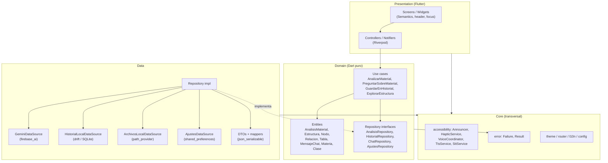
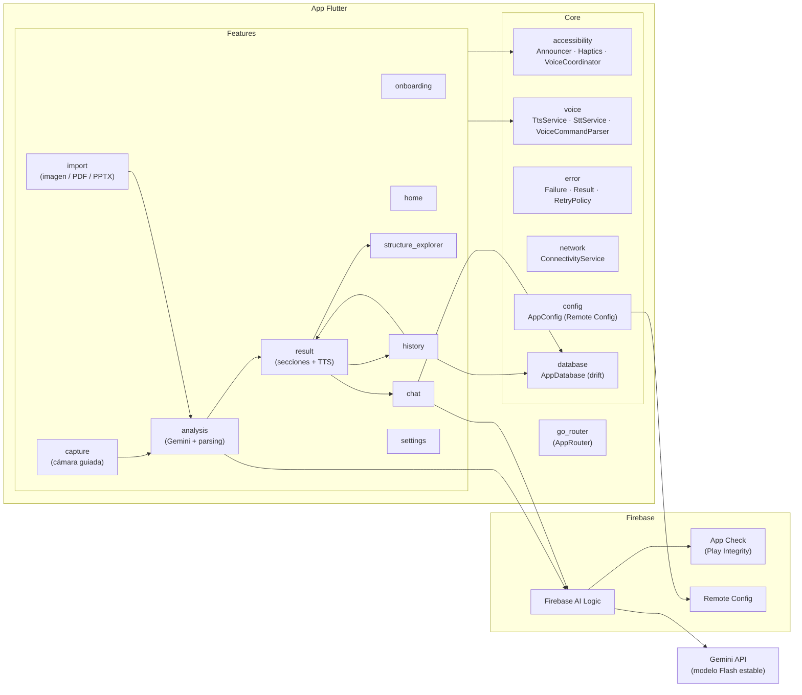
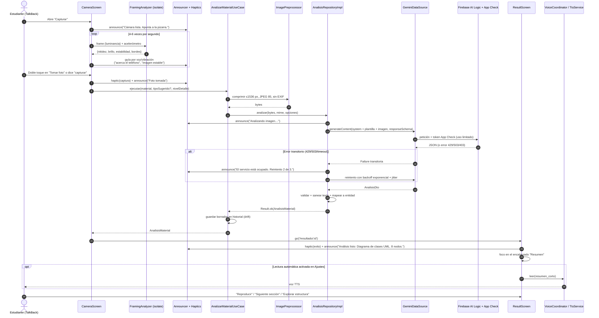
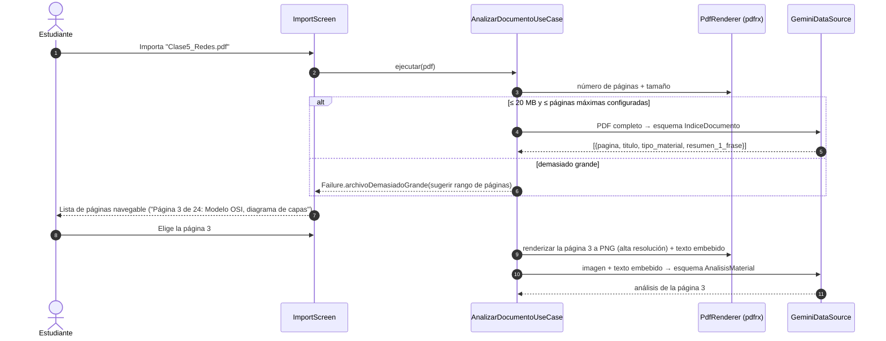
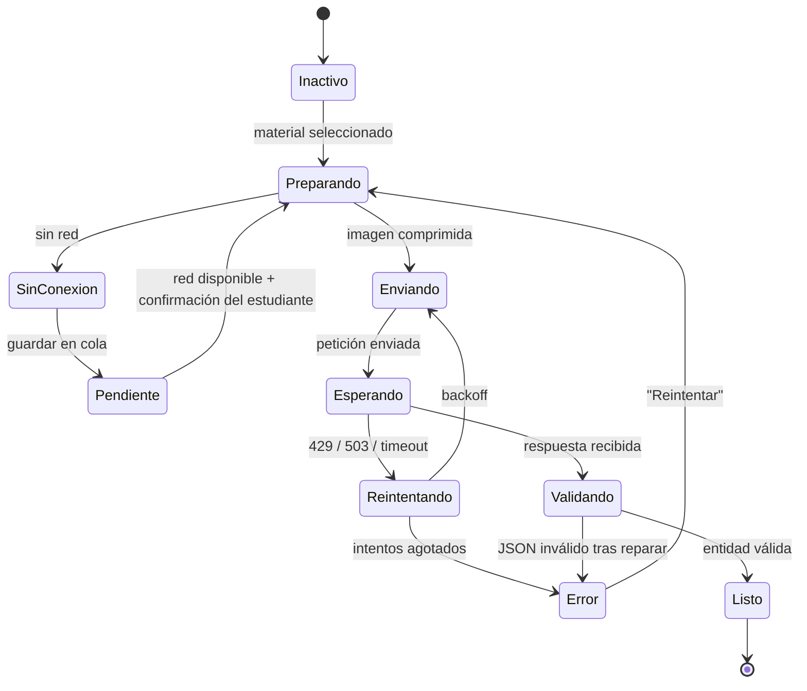
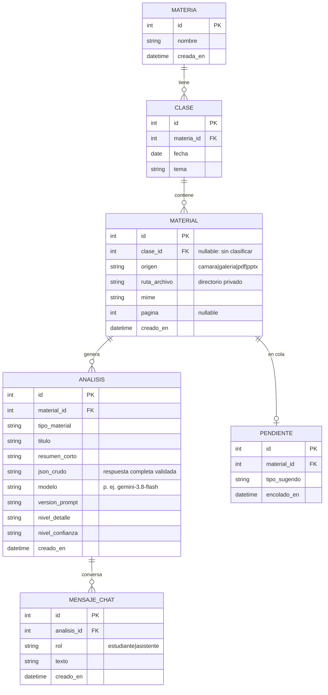
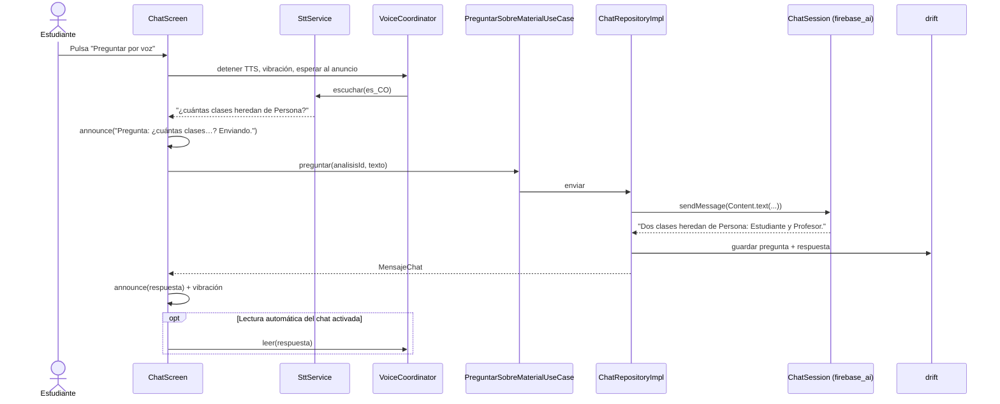

# VisionDesc UdeA — Documento de arquitectura

> **Estado:** Fase 1 (diseño, sin código) · **Versión del documento:** 1.1 · **Fecha:** 2026-10-14
> **Plataforma:** solo Android (decisión D9) · **Framework:** Flutter estable (3.47 o superior, Dart 3.13+)
>
> **Alcance actual (decisión D10):** documentación y un front de demostración responsivo (pantallas y botones con datos de ejemplo). La IA, la cámara, la voz y la base de datos descritas aquí son el **diseño objetivo** y aún no están implementadas.

---

## Índice

1. [Visión general y requisitos](#1-visión-general-y-requisitos)
2. [Arquitectura limpia por features](#2-arquitectura-limpia-por-features)
3. [Stack tecnológico y justificación](#3-stack-tecnológico-y-justificación)
4. [Diseño de prompts y salida estructurada](#4-diseño-de-prompts-y-salida-estructurada)
5. [Modo conversación](#5-modo-conversación)
6. [Errores, reintentos, cuotas, sin conexión y privacidad](#6-errores-reintentos-cuotas-sin-conexión-y-privacidad)
7. [Estructura de carpetas](#7-estructura-de-carpetas)
8. [Matriz de cumplimiento WCAG 2.2](#8-matriz-de-cumplimiento-wcag-22)
9. [Estrategia de pruebas](#9-estrategia-de-pruebas)
10. [Registro de decisiones](#10-registro-de-decisiones)

---

## 1. Visión general y requisitos

### 1.1 Propósito

VisionDesc es una app móvil que convierte el material visual de clase en **descripciones accesibles, estructuradas y navegables** para estudiantes ciegos de Ingeniería de Sistemas. El estudiante fotografía la pizarra o una diapositiva, o importa un PDF, y la app:

1. Analiza el material con Google Gemini (multimodal).
2. Devuelve un **resumen corto**, una **descripción espacial detallada**, la **estructura** del contenido (nodos y relaciones, jerarquías, tablas) y el **texto y código** detectados.
3. Permite **explorar el diagrama nodo por nodo**, **escuchar** el contenido con controles de reproducción y **hacer preguntas de seguimiento** por voz o por texto.
4. Guarda todo en un **historial local organizado por materia y clase** que funciona sin conexión.

### 1.2 Usuarios

| Perfil | Necesidades principales |
|---|---|
| **Estudiante ciego** (usuario principal) | Uso completo con TalkBack, sin depender de nada visual. Ayuda por voz y vibración para encuadrar la foto. Navegación por encabezados. Respuestas que no tenga que "adivinar". |
| Estudiante con baja visión | Tema de alto contraste, texto escalable hasta 200 % o más, botones grandes. |
| Estudiante con movilidad reducida | Comandos por voz, Switch Access, teclado externo. Ninguna acción exige gestos complejos. |

### 1.3 Requisitos funcionales

| ID | Requisito |
|---|---|
| RF-01 | Capturar una foto con cámara guiada por voz y vibración (encuadre, estabilidad, iluminación, nitidez). |
| RF-02 | Importar una imagen de la galería (`image_picker`) o un archivo PDF o PPTX (`file_picker`). |
| RF-03 | Enviar el material a Gemini y recibir un análisis en **JSON estructurado** con el esquema de la sección 4. |
| RF-04 | Detectar automáticamente el tipo de material. Opcionalmente el estudiante lo indica ("es un diagrama entidad-relación") para mejorar la precisión. |
| RF-05 | Mostrar el resultado en secciones navegables por encabezados: Resumen, Descripción detallada, Estructura, Texto y Código, Advertencias. |
| RF-06 | Leer en voz alta con TTS, con controles de reproducir/pausar, velocidad, repetir sección y saltar a la sección anterior o siguiente. |
| RF-07 | Explorar la estructura nodo por nodo: vecinos, relaciones entrantes y salientes, cardinalidades, jerarquía padre-hijos y celdas de tabla con su encabezado de columna. |
| RF-08 | Hacer preguntas de seguimiento sobre el mismo material (chat multimodal con contexto), por voz o por texto. |
| RF-09 | Guardar el análisis en el historial y asignarle una materia y una clase (fecha y tema). |
| RF-10 | Buscar y filtrar el historial por materia, fecha, tipo de material y texto libre. |
| RF-11 | Copiar al portapapeles, exportar a `.txt` y compartir con el diálogo nativo. |
| RF-12 | Comandos de voz globales: "capturar", "importar", "historial", "ajustes", "repetir", "pausa", "siguiente", "anterior", "preguntar…". |
| RF-13 | Configurar velocidad y tono de voz, nivel de detalle (breve, estándar, exhaustivo), **variante de la voz en español** (es-CO, es-MX, es-ES, según las voces instaladas), tema (claro, oscuro, alto contraste) y retroalimentación háptica. La v1 está **solo en español** (decisión D6). El idioma queda parametrizado (`{idioma}` en el prompt, ARB por idioma) para añadir otros más adelante. |
| RF-14 | Gestionar la privacidad: consentimiento informado, borrar un elemento, borrar una materia y borrar todos los datos. |
| RF-15 | Para PDF de varias páginas: generar primero un índice por página y luego el análisis detallado de la página que el estudiante elija. |

### 1.4 Requisitos no funcionales

#### Accesibilidad (requisito central)

| ID | Requisito | Verificación |
|---|---|---|
| RNF-A1 | Cumplimiento de **WCAG 2.2 nivel AA** aplicado a móvil (matriz en la sección 8). | Tests de widgets, auditoría manual con TalkBack. |
| RNF-A2 | Todo elemento interactivo tiene un `Semantics` con etiqueta, rol y estado. Las imágenes decorativas se excluyen. | `labeledTapTargetGuideline`. |
| RNF-A3 | Áreas táctiles de **48 × 48 dp como mínimo** (más estricto que el 24 × 24 px de WCAG 2.5.8). Los botones principales del inicio miden al menos 88 dp de alto. | `androidTapTargetGuideline`. |
| RNF-A4 | Contraste de texto ≥ 4.5:1 (AA) y de componentes no textuales ≥ 3:1. En el tema de alto contraste, ≥ 7:1 (AAA). | `textContrastGuideline` y pruebas de tokens de color. |
| RNF-A5 | Escalado de texto hasta 200 % sin desbordamientos ni truncamientos (textScaler 2.0 en las pruebas). | Tests de widgets con `MediaQuery(textScaler: TextScaler.linear(2.0))`. |
| RNF-A6 | Ninguna función depende solo de gestos multi-dedo, de arrastres ni de pistas visuales. Toda acción tiene un botón equivalente y, cuando aplica, un comando de voz. | Revisión de diseño. |
| RNF-A7 | Los cambios de estado (procesando, error, éxito) se comunican con un anuncio del lector de pantalla y vibración, nunca solo con un spinner o un color. | Tests de widgets sobre los anuncios (mock del `Announcer`). |
| RNF-A8 | Orden de foco lógico. Los encabezados se marcan con `header: true`. Al cambiar de pantalla, el foco va al título. | Tests de semántica. |
| RNF-A9 | El contenido generado por IA es **texto plano legible por lector de pantalla**: sin Markdown, sin emojis y sin símbolos que el lector pronuncie de forma confusa. | Reglas del prompt y saneamiento en la capa `data`. |
| RNF-A10 | Una sola voz a la vez: el TTS de la app nunca se superpone a anuncios críticos ni al micrófono (ver 3.7). | Tests del `VoiceCoordinator`. |

#### Privacidad y seguridad

| ID | Requisito |
|---|---|
| RNF-P1 | Ninguna clave de API en el cliente ni en el repositorio. El acceso a Gemini se hace mediante Firebase AI Logic con **App Check** obligatorio. |
| RNF-P2 | Solo se envía a Gemini el material que el estudiante elige analizar, sin metadatos EXIF (GPS, dispositivo). |
| RNF-P3 | El historial (imágenes, análisis y chats) se guarda **solo en el dispositivo**, en el directorio privado de la app. No va a la galería ni a la nube. |
| RNF-P4 | Consentimiento explícito en el onboarding, revocable desde Ajustes. Informa que en el nivel gratuito de la Gemini API Google puede usar el contenido para mejorar sus productos. Cumple la Ley 1581 de 2012 (Habeas Data, Colombia). |
| RNF-P5 | El prompt indica no identificar ni describir rasgos de personas que aparezcan en la foto (por ejemplo, el profesor frente a la pizarra). |

#### Rendimiento y latencia

| ID | Requisito | Objetivo |
|---|---|---|
| RNF-L1 | Respuesta háptica y anuncio al pulsar "Capturar" o "Analizar". | < 300 ms |
| RNF-L2 | Resumen corto disponible para una imagen (≤ 1 MB tras la compresión) en 4G. | p50 ≤ 6 s, p95 ≤ 12 s |
| RNF-L3 | Retroalimentación de encuadre en la cámara guiada. | 4-6 evaluaciones por segundo, sin bloquear la UI (cálculo en un isolate) |
| RNF-L4 | Apertura del historial con 1000 elementos. | < 500 ms |
| RNF-L5 | Arranque en frío hasta la pantalla de inicio usable. | < 2.5 s en un equipo de gama media |

#### Funcionamiento sin conexión

| ID | Requisito |
|---|---|
| RNF-O1 | El historial, la pantalla de resultados, el explorador de estructura, la lectura TTS y la exportación funcionan **sin conexión**. |
| RNF-O2 | Sin conexión, el estudiante puede capturar igualmente. La captura queda en una cola de **"pendientes por analizar"** y la app avisa cuando vuelve la conexión. No se envía nada sin una nueva confirmación del estudiante. |
| RNF-O3 | El chat y el análisis requieren conexión. La app lo anuncia de forma clara y no muestra un error genérico. |

#### Mantenibilidad

| ID | Requisito |
|---|---|
| RNF-M1 | Arquitectura limpia con dependencias que apuntan hacia `domain`. Las capas `domain` no importan Flutter ni paquetes de terceros (salvo utilidades puras). |
| RNF-M2 | El modelo de Gemini, la versión del prompt y los límites se configuran sin publicar una nueva versión (Firebase Remote Config con valores por defecto en constantes). |
| RNF-M3 | Cobertura de tests ≥ 80 % en `domain` y `data`. Cada pantalla tiene tests de semántica. |
| RNF-M4 | `flutter analyze` sin advertencias, con `flutter_lints` y reglas adicionales (ver 3.10). |

---

## 2. Arquitectura limpia por features

### 2.1 Principios

- **Feature-first:** cada funcionalidad (captura, análisis, resultado, chat…) es un módulo con sus propias capas `presentation / domain / data`.
- **Regla de dependencia:** `presentation → domain ← data`. El dominio define interfaces (repositorios) y `data` las implementa. Riverpod hace la inyección de dependencias.
- **El dominio compartido** del análisis (entidades `AnalisisMaterial`, `Estructura`, `Nodo`, `Relacion`…) vive en la feature `analysis`. Las demás features pueden depender de `analysis/domain`, pero **nunca de la capa `data` ni de la capa `presentation` de otra feature**.
- **`core`** contiene lo transversal: tema, router, accesibilidad (anuncios, háptica, coordinador de voz), errores, red, configuración remota y localización.
- **Accesibilidad como servicio:** ninguna pantalla llama directamente a `SemanticsService`, `HapticFeedback` ni `FlutterTts`. Lo hacen a través de abstracciones de `core/accessibility` que se pueden simular en los tests.

### 2.2 Diagrama de capas



### 2.3 Diagrama de componentes



### 2.4 Secuencia principal: capturar → Gemini → descripción → lectura en voz alta



### 2.5 Secuencia del análisis de PDF (índice y luego detalle)



### 2.6 Flujo de estados del análisis



Cada transición tiene **un anuncio por voz y un patrón háptico** asociado (tabla en 3.8). El estado se expone como un `AsyncValue` o un `sealed class EstadoAnalisis`, que la UI convierte en un mensaje accesible.

---

## 3. Stack tecnológico y justificación

> Las versiones exactas se fijan en la Fase 3 con `flutter pub add`, usando la última estable compatible. A la fecha: Flutter 3.41.7 instalado (hay una actualización disponible) y `firebase_ai` 4.0.0.

### 3.1 Resumen

| Área | Paquete(s) | Motivo |
|---|---|---|
| Estado + DI | `flutter_riverpod`, `riverpod_annotation`, `riverpod_generator` | Ver 3.2 |
| Navegación | `go_router` | Rutas declarativas, deep links y `redirect` para el onboarding y el consentimiento. |
| IA | `firebase_core`, `firebase_ai`, `firebase_app_check`, `firebase_remote_config` | Ver 3.4 |
| Captura | `camera`, `sensors_plus`, `permission_handler` | Ver 3.5 |
| Importación | `image_picker`, `file_picker`, `pdfrx` | Ver 3.6 |
| Preprocesado de imagen | `flutter_image_compress` | Redimensiona y comprime de forma nativa. Elimina los EXIF. |
| Voz | `flutter_tts`, `speech_to_text` | Ver 3.7 |
| Háptica | `HapticFeedback` (SDK) + `vibration` | Ver 3.8 |
| Persistencia | `drift`, `drift_flutter`, `sqlite3_flutter_libs`, `path_provider` | Ver 3.9 |
| Ajustes | `shared_preferences` | Lectura síncrona al arrancar (tema, escala, voz). |
| Modelos | `freezed`, `json_serializable` | Inmutabilidad, `copyWith` y uniones selladas. |
| Red | `connectivity_plus` | Detecta si hay conexión para la cola de pendientes. |
| Exportar y compartir | `share_plus` | Comparte el `.txt` con el diálogo nativo (accesible). |
| Localización | `flutter_localizations`, `intl` (ARB) | Todo el texto en `lib/l10n/app_es.arb`. |
| Tests | `flutter_test`, `mocktail`, `drift` (en memoria) | Ver la sección 9. |
| Lint | `flutter_lints` + reglas extra | Ver 3.10. |
| PPTX | `archive`, `xml` | Abrir el ZIP del PPTX y leer el XML de cada diapositiva (ver 3.6). |
| *Pospuesto* | `google_mlkit_text_recognition` | Guía de encuadre basada en texto cortado en el borde (ver 3.5). Después de la v1. |

### 3.2 Gestión de estado: Riverpod (elegido)

| Criterio | Riverpod 3 | Bloc/Cubit | Provider |
|---|---|---|---|
| Inyección de dependencias integrada | ✅ `ref.watch` y overrides | ❌ requiere `get_it` o `RepositoryProvider` | Parcial |
| Pruebas sin `BuildContext` | ✅ `ProviderContainer` + overrides | ✅ | ❌ |
| Estados de carga y error | ✅ `AsyncValue` nativo | Manual (estados) | Manual |
| Cancelación al salir de la pantalla | ✅ `autoDispose` + `ref.onDispose` (cancela la petición a Gemini) | Manual | Manual |
| Código repetitivo | Bajo (generador) | Alto | Bajo |

**Justificación:** `AsyncValue` se corresponde directamente con los estados que hay que **anunciar** (cargando, error, datos), lo que centraliza los anuncios accesibles en un solo lugar (`ref.listen` → `Announcer`). Los overrides facilitan los tests de widgets con el `Announcer` y el `TtsService` simulados. Bloc también sería válido; se descarta por el código adicional y porque requiere un contenedor de DI aparte.

### 3.3 Navegación: go_router

- `redirect` global: si no hay consentimiento ni onboarding completo, va a `/onboarding`.
- Rutas: `/onboarding`, `/`, `/capturar`, `/importar`, `/procesando`, `/resultado/:id`, `/resultado/:id/estructura`, `/resultado/:id/chat`, `/historial`, `/ajustes`.
- **Al cambiar de ruta**, cada pantalla pone el foco en su título (`header: true`) y anuncia su nombre. Se implementa con un `RouteAnnouncer` (observer) en `core/router`.
- Las transiciones respetan `MediaQuery.disableAnimations` (reducir movimiento).

### 3.4 IA: Gemini mediante Firebase AI Logic (`firebase_ai`)

#### Configuración propuesta

```text
Plan Firebase:  Spark (gratuito) → Gemini Developer API, nivel gratuito   [decisión D1]
Backend:        FirebaseAI.googleAI(useLimitedUseAppCheckTokens: true)
Alternativa:    FirebaseAI.agentPlatform(...)  (antes vertexAI; requiere Blaze; no se usa en v1)
Modelo:         constante AppConfig.defaultModel = 'gemini-3.8-flash'   (gratuito en el nivel free)
                sobrescribible con Remote Config: 'gemini_model'
Respaldo:       AppConfig.fallbackModel = 'gemini-3.5-flash-lite'
                (gratuito, estable, retiro no antes de 2027-07-21)
Salida:         responseMimeType: 'application/json' + responseSchema
Razonamiento:   ThinkingConfig con nivel bajo para análisis (menor latencia); configurable
Temperatura:    0.2 (descripciones fieles, poca creatividad)
Máx. tokens:    8192 en el análisis, 1024 en las respuestas del chat
Resolución:     mediaResolution configurable (alta para pizarras y código)
```

**Sobre el modelo:** según la [lista oficial de modelos de Firebase AI Logic](https://firebase.google.com/docs/ai-logic/models), el Flash estable más reciente es `gemini-3.8-flash` (publicado el 2026-09-02). Firebase lo marca como de **disponibilidad a corto plazo** en Agent Platform y su fecha de retiro aún no está definida. Por eso:

1. El modelo es una **constante** (`lib/core/config/app_config.dart`) y además un parámetro de **Remote Config**. Cambiar de modelo no requiere publicar una nueva versión de la app.
2. Se define `gemini-3.5-flash-lite` como **respaldo**: es gratuito en el nivel free y tiene fecha de retiro garantizada. Si el modelo principal responde 404 (retirado), la app cambia automáticamente al respaldo. `gemini-3.5-flash` no aparece en la tabla de precios gratuitos de la Gemini API, por eso no se usa como respaldo.
3. No se usan alias `-latest` ni modelos `preview` en producción, como recomienda el checklist de producción de Firebase.

**App Check:** Firebase anuncia que **desde el 2 de noviembre de 2026 App Check será obligatorio** para usar Firebase AI Logic. Se configura así:
- **Producción:** Play Integrity. **Desarrollo:** proveedor de depuración con el token registrado en la consola, que nunca se sube al repositorio.
- **Tokens de uso limitado** (`useLimitedUseAppCheckTokens: true`) para poder activar la protección contra repetición. Cada token cuesta algo de latencia; el indicador también vive en Remote Config.

#### Comparación: Firebase AI Logic frente a un backend proxy propio

| Criterio | **Firebase AI Logic + App Check** (recomendado) | **Backend proxy propio** (Cloud Run o Cloud Functions + SDK de servidor) |
|---|---|---|
| Clave de API | No existe en el cliente; Firebase la gestiona | Vive en el servidor (Secret Manager) |
| Protección contra abuso | App Check integrado y límite por usuario configurable en la consola | Hay que verificar App Check o Auth y limitar la tasa manualmente |
| Latencia | Un salto menos | Un salto adicional (+50-300 ms) y arranques en frío |
| Infraestructura y coste | Ninguna adicional | Servidor, despliegue, monitorización y facturación propia |
| Prompts | En el cliente (o en plantillas de servidor de Firebase, ver abajo) | Ocultos en el servidor; se pueden cambiar sin publicar la app |
| Procesamiento extra | Limitado a lo que hace el cliente | Puede convertir PPTX a PDF (LibreOffice), hacer OCR previo, auditar y aplicar cuotas institucionales |
| Multimodal y chat | Soporte directo (`startChat`, `InlineDataPart`) | Hay que reimplementar el protocolo de chat |
| Complejidad para un equipo pequeño | Baja | Media-alta |

**Recomendación:** Firebase AI Logic + App Check + Remote Config. Se evaluará la función de **plantillas de prompt en servidor** de `firebase_ai` (disponible desde la 3.6) para mover el prompt de sistema al servidor si se quiere cambiarlo sin publicar la app. Un **proxy propio** se justificaría más adelante solo si se necesita convertir PPTX en el servidor, integrar autenticación institucional de la UdeA o auditar el uso.

#### Plan gratuito (Spark): consecuencias y mitigaciones (decisión D1)

La [tabla de precios de la Gemini API](https://ai.google.dev/gemini-api/docs/pricing) indica, para `gemini-3.8-flash`, *"Used to improve our products: Free Tier **Yes**, Paid Tier No"*. Es decir, **Google puede usar las imágenes y preguntas enviadas para mejorar sus productos**. Para manejarlo:

| Consecuencia | Mitigación en el diseño |
|---|---|
| Google puede usar el contenido enviado | El **consentimiento del onboarding lo dice explícitamente** (6.5). Se recomienda al estudiante no fotografiar documentos con datos personales. Se eliminan los EXIF y el prompt no identifica personas. |
| Cuotas gratuitas bajas (por minuto y por día; los valores vigentes se ven en AI Studio) | Limitador local configurable, manejo de 429 con mensaje claro ("Se alcanzó el límite gratuito de hoy; podrás analizar de nuevo mañana"), índice de PDF + detalle por página, compresión de imágenes. |
| Los modelos `preview` y algunos otros requieren facturación | Solo se usan modelos estables con nivel gratuito (`gemini-3.8-flash`, `gemini-3.5-flash-lite`). |
| Agent Platform no está disponible | Se usa `googleAI`. |

**Migrar a Blaze más adelante** no requiere cambios de código: solo se activa la facturación en el proyecto de Firebase y se actualiza el texto del consentimiento (versión nueva → se pide de nuevo).

### 3.5 Captura: `camera` + guía de encuadre

Se usa `camera` (no solo `image_picker`) porque la cámara guiada necesita el **flujo de fotogramas** (`startImageStream`) para evaluar la calidad en tiempo real.

`FramingAnalyzer` (dominio puro, ejecutado en un isolate) calcula, sobre el plano de luminancia (Y) submuestreado:

| Métrica | Cálculo | Guía resultante |
|---|---|---|
| Brillo | Media de luminancia | "Hay poca luz" / "Hay un reflejo fuerte" |
| Nitidez | Varianza del Laplaciano | "La imagen está borrosa, mantén el teléfono quieto" |
| Estabilidad | Magnitud del giroscopio y el acelerómetro (`sensors_plus`) en una ventana de 500 ms | Vibración corta continua mientras se mueve; doble vibración al quedar "estable" |
| Contenido en los bordes | Densidad de bordes (Sobel) en franjas laterales frente al centro | "Hay contenido cortado a la izquierda, gira un poco a la izquierda" |
| Distancia (heurística) | Proporción del área con bordes de alto contraste | "Acerca el teléfono" / "Aleja el teléfono" |

- **Antirrebote de voz:** el mismo mensaje no se repite antes de 3 s, y no se habla mientras el lector de pantalla está anunciando algo.
- **Captura automática opcional:** cuando la imagen está estable, nítida y bien iluminada durante 1 s, se anuncia "Imagen estable" y, si el ajuste está activado, se captura sola. Si no, se espera al botón o al comando de voz "capturar".
- **Pospuesto para después de la v1 (decisión D4):** `google_mlkit_text_recognition` para detectar texto cortado en el borde del encuadre. La v1 usa solo las heurísticas anteriores. `FramingAnalyzer` se define como una interfaz para poder añadir esta implementación más adelante sin tocar la UI.

### 3.6 Importación: imágenes, PDF y PPTX

| Formato | Tratamiento |
|---|---|
| JPEG, PNG, HEIC, WebP | `image_picker` o `file_picker` → `ImagePreprocessor` (≤ 1536 px en el lado largo, JPEG calidad 85, sin EXIF). |
| **PDF** | Gemini lo admite de forma nativa (`application/pdf`). Hasta 20 MB se envía *inline* para generar el **índice**. El detalle de cada página se obtiene renderizándola con `pdfrx` (que además extrae el texto embebido para mejorar la precisión). Así la lógica es la misma que con las fotos y se ahorran tokens al no reenviar el PDF completo en cada pregunta. |
| **PPTX** | Gemini **no** admite PPTX como entrada. Se extraen en el dispositivo **las imágenes y el texto de cada diapositiva** (decisión D3). Detalle en 3.6.1. |
| Otros | Mensaje accesible: "Formato no compatible. Usa una imagen, un PDF o un PPTX." |

#### 3.6.1 Extracción de PPTX por diapositiva (decisión D3)

Un archivo PPTX es un ZIP con XML. **No contiene una imagen ya renderizada de cada diapositiva** (solo, a veces, una miniatura de la primera en `docProps/thumbnail.jpeg`), y renderizarla en el teléfono requeriría un motor de presentaciones. Por eso, para cada diapositiva se extrae lo siguiente y se envía a Gemini:

| Paso | Fuente dentro del ZIP | Resultado |
|---|---|---|
| 1. Orden de las diapositivas | `ppt/presentation.xml` (`p:sldIdLst`) + `ppt/_rels/presentation.xml.rels` | Lista ordenada: diapositiva 1 → `slide3.xml`, etc. |
| 2. Texto en orden de lectura | `ppt/slides/slideN.xml`: formas `p:sp` con `a:t`, ordenadas por posición (`a:off` y, de arriba abajo, de izquierda a derecha), conservando el nivel de viñeta (`a:pPr lvl`) y marcando el título (`p:ph type="title"`) | Texto estructurado de la diapositiva |
| 3. Imágenes de la diapositiva | `ppt/slides/_rels/slideN.xml.rels` → `ppt/media/*` (PNG, JPEG, GIF), con su posición y su texto alternativo si lo tiene (`p:cNvPr descr`) | Una o varias imágenes (diagramas, capturas) |
| 4. Tablas | `a:tbl` dentro de `p:graphicFrame` | Filas y celdas como texto |
| 5. Notas del orador | `ppt/notesSlides/notesSlideN.xml` | Texto de notas (opcional, suele aportar contexto) |

**Flujo:** igual que con el PDF. Primero se genera un **índice de diapositivas** localmente, sin llamar a Gemini (con el título y el número de imágenes de cada una). Luego el estudiante elige una diapositiva y se envía `[texto estructurado + InlineDataPart por cada imagen]` con la plantilla "diapositiva".

**Limitaciones (se anuncian al estudiante):**
- La disposición visual exacta (formas dibujadas con las herramientas de PowerPoint, flechas o SmartArt sin imagen) no se reconstruye como imagen. El texto y la posición de las formas sí se envían, y el prompt pide no inferir conexiones que no estén explícitas. La primera vez se anuncia: "La disposición visual de las diapositivas puede no ser exacta. Para mayor precisión, exporta la presentación a PDF".
- Las imágenes EMF y WMF (frecuentes en diagramas de Office) no son compatibles con Gemini: se omiten y se añade la advertencia "La diapositiva contiene un gráfico en formato no compatible".
- Los gráficos de datos nativos (`c:chart`) se envían como sus datos en texto (`ppt/charts/chartN.xml`: series y valores).

Implementado en `features/import/data/pptx_extractor.dart` como lógica pura, probada con PPTX de prueba en `test/fixtures/pptx/`.

### 3.7 Voz: `flutter_tts` y `speech_to_text`

**Problema central:** el estudiante ya tiene un lector de pantalla que habla. Si la app también habla con TTS se superponen dos voces, y el micrófono puede capturar la voz del propio lector.

**Solución: `VoiceCoordinator` (core/accessibility)**, un árbitro único de salida y entrada de audio:

| Situación | Comportamiento |
|---|---|
| Mensajes cortos de estado ("Analizando…", "Foto tomada") | Se usa `Announcer` (anuncio del lector de pantalla), **no** el TTS. Así respetan la voz, la velocidad y el idioma que el estudiante configuró en TalkBack. |
| Lectura larga (descripción, resumen) iniciada por el estudiante | TTS de la app, con controles de reproducción y lectura **por secciones y frases**, para poder repetir y saltar. |
| Lector de pantalla activo (`MediaQuery.accessibleNavigation`) | La lectura automática del TTS queda **desactivada por defecto**. El contenido está igualmente disponible como texto semántico navegable con el lector. |
| Pulsar el micrófono | 1) Se detiene el TTS; 2) vibración corta; 3) se espera a que termine el anuncio del lector (unos 600 ms configurables); 4) empieza la escucha. Al terminar: vibración doble y se anuncia lo reconocido ("Entendí: siguiente sección"). |
| TTS hablando y llega un error crítico | Se pausa el TTS, se anuncia el error y se ofrece reanudar. |

**Lectura de código:** el TTS usa un modo de verbalización de símbolos (`{` → "abre llave", `!=` → "distinto de", sangría → "nivel 2"). En pantalla, el código se presenta **línea por línea** como nodos semánticos ("Línea 4: if usuario es nulo…") para que el lector permita recorrerlo.

**Idioma:** TTS en `es-CO`, o en `es-419`/`es-ES` como respaldo, según las voces instaladas. Si no hay ninguna voz en español, se avisa y se ofrece abrir los ajustes de TTS del sistema.

**Reconocimiento de voz:** `speech_to_text` con `localeId: es_CO` y reconocimiento en el dispositivo cuando el sistema lo permite (privacidad y funcionamiento sin conexión). Los **comandos** se interpretan localmente con `VoiceCommandParser`: normaliza tildes y mayúsculas, admite sinónimos ("tomar foto" = "capturar") y usa coincidencia aproximada. **No se usa Gemini** para interpretar comandos, por latencia y para poder funcionar sin conexión. Lo que no es un comando se envía como pregunta al chat si el estudiante está en un resultado.

### 3.8 Retroalimentación háptica

`HapticService` usa `HapticFeedback` (SDK) para lo básico y `vibration` para patrones. **La vibración nunca es el único canal:** siempre va acompañada de un anuncio (WCAG 1.3.3). Se puede desactivar en Ajustes.

| Evento | Patrón | Anuncio |
|---|---|---|
| Botón pulsado | `selectionClick` | (lo dice el lector) |
| Foto tomada | 1 pulso medio (80 ms) | "Foto tomada" |
| Imagen estable (cámara) | 2 pulsos cortos | "Imagen estable" |
| Moviendo (cámara) | Pulso corto cada 400 ms | (sin voz, para no saturar) |
| Análisis listo | 3 pulsos cortos ascendentes | "Análisis listo: …" |
| Error | 1 pulso largo (400 ms) | Mensaje del error + acción sugerida |
| Inicio y fin de escucha | 1 corto / 2 cortos | "Escuchando" / "Entendí: …" |

### 3.9 Persistencia: drift (SQLite)



- **Búsqueda de texto completo** con una tabla virtual **FTS5** sobre `titulo`, `resumen_corto`, `conceptos_clave` y `texto_detectado`.
- `json_crudo` guarda la respuesta íntegra. Si el esquema cambia, se puede volver a mapear sin perder datos. Se guardan `modelo` y `version_prompt` por trazabilidad.
- Los archivos (imágenes, PDF) se guardan en `getApplicationSupportDirectory()/materiales/`, que la galería no indexa. La copia de seguridad automática de Android está desactivada (`android:allowBackup="false"`), para que el historial no salga del teléfono.
- Migraciones versionadas con `schemaVersion` y tests de migración de drift.
- *Cifrado en reposo:* se confía en el cifrado del sistema (cifrado basado en archivos de Android). Usar SQLCipher queda como opción futura.

### 3.10 Calidad de código

- `analysis_options.yaml`: `flutter_lints`, `strict-casts`, `strict-inference`, `strict-raw-types`, `prefer_const_constructors`, `always_declare_return_types`, `avoid_print`, `public_member_api_docs` (solo `domain`).
- Generación de código con `build_runner` (`riverpod_generator`, `freezed`, `json_serializable`, `drift_dev`). Los archivos `*.g.dart` y `*.freezed.dart` se versionan para que el proyecto compile sin regenerarlos (decisión revisable).
- **Sin claves en el repositorio:** `.gitignore` incluye `google-services.json`, `lib/firebase_options.dart`, `dart_defines.json` y `*.env`. El README explica cómo generarlos con `flutterfire configure`.

---

## 4. Diseño de prompts y salida estructurada

### 4.1 Estrategia

- **Una sola llamada** por análisis: el prompt de sistema contiene las reglas generales y las específicas de cada tipo, y el modelo **detecta el tipo**. Dos llamadas (clasificar y luego describir) duplicarían la latencia.
- Si el estudiante indica el tipo (por voz o con un selector) o pide "analizar de nuevo como tabla", se añade la **plantilla específica** de ese tipo al mensaje de usuario.
- El **nivel de detalle** (breve, estándar o exhaustivo) y el **idioma** de salida se insertan como variables.
- Los prompts están versionados (`PromptVersion = 'v1.0'`) en `features/analysis/data/prompts/` y la versión se guarda junto a cada análisis.
- `temperature: 0.2`, `responseMimeType: application/json` y `responseSchema`. La salida se valida en `data` antes de mapearla al dominio.

### 4.2 Esquema de respuesta (`responseSchema`)

Decisiones de diseño del esquema:
- **La jerarquía es plana** (`padre_id` en cada nodo) en lugar de recursiva: el subconjunto de esquemas que admite Gemini no garantiza la recursión, y una lista plana es más fácil de recorrer nodo por nodo. El dominio reconstruye el árbol.
- **Las filas de tabla son objetos** (`{celdas: [...]}`) en lugar de arreglos anidados, para mayor compatibilidad del esquema.
- **`descripcion_detallada` es una lista de párrafos por región** (`{region, texto}`) en lugar de un solo bloque. Así cada región es un nodo navegable con el lector y el TTS puede "repetir sección". El texto completo es la concatenación de los párrafos.
- **`nivel_confianza` es categórico** (alto, medio, bajo) y no numérico: los porcentajes que da un LLM no están calibrados y sugerirían una precisión que no existe. Cada nodo y relación lleva además un indicador `incierto`.
- El orden de las propiedades (`propertyOrdering`) pone `resumen_corto` primero. Esto permite, en una optimización futura con *streaming*, leer el resumen antes de que termine la respuesta.

```jsonc
{
  "type": "object",
  "propertyOrdering": ["tipo_material", "titulo", "resumen_corto", "descripcion_detallada",
    "estructura", "texto_detectado", "codigo_detectado", "conceptos_clave",
    "nivel_confianza", "advertencias"],
  "required": ["tipo_material", "titulo", "resumen_corto", "descripcion_detallada",
    "nivel_confianza", "advertencias"],
  "properties": {
    "tipo_material": {
      "type": "string",
      "enum": ["diagrama_uml_clases", "diagrama_uml_secuencia", "diagrama_uml_casos_uso",
        "diagrama_uml_actividades", "diagrama_uml_estados", "diagrama_uml_otro",
        "diagrama_entidad_relacion", "diagrama_flujo", "diagrama_red",
        "diagrama_arquitectura", "mapa_mental", "diapositiva", "pizarra",
        "captura_codigo", "tabla", "grafico_datos", "documento_texto", "otro"]
    },
    "titulo": { "type": "string", "description": "Título visible o, si no hay, uno descriptivo de máximo 10 palabras." },
    "resumen_corto": { "type": "string", "description": "2 a 3 frases: qué es y cuál es la idea principal." },
    "descripcion_detallada": {
      "type": "array",
      "description": "Recorrido espacial: de arriba abajo y de izquierda a derecha.",
      "items": {
        "type": "object",
        "required": ["region", "texto"],
        "properties": {
          "region": { "type": "string", "description": "Ej.: 'Parte superior izquierda'." },
          "texto": { "type": "string" }
        }
      }
    },
    "estructura": {
      "type": "object",
      "nullable": true,
      "properties": {
        "nodos": {
          "type": "array",
          "items": {
            "type": "object",
            "required": ["id", "etiqueta", "tipo"],
            "properties": {
              "id": { "type": "string", "description": "Identificador corto: n1, n2…" },
              "etiqueta": { "type": "string" },
              "tipo": { "type": "string", "description": "clase, interfaz, entidad, actor, caso_uso, proceso, decision, inicio_fin, router, switch, servidor, servicio, base_datos, idea_central, rama, nota…" },
              "atributos": { "type": "array", "items": { "type": "string" } },
              "metodos": { "type": "array", "items": { "type": "string" } },
              "padre_id": { "type": "string", "nullable": true, "description": "Para jerarquías (mapas mentales, paquetes)." },
              "nivel": { "type": "integer", "description": "0 = raíz." },
              "posicion": { "type": "string", "description": "Ubicación aproximada: 'superior centro'." },
              "incierto": { "type": "boolean" }
            }
          }
        },
        "relaciones": {
          "type": "array",
          "items": {
            "type": "object",
            "required": ["origen_id", "destino_id", "tipo"],
            "properties": {
              "origen_id": { "type": "string" },
              "destino_id": { "type": "string" },
              "tipo": { "type": "string", "description": "asociacion, herencia, realizacion, composicion, agregacion, dependencia, flujo, mensaje, conexion_red, incluye, extiende, relacion_er…" },
              "etiqueta": { "type": "string", "nullable": true },
              "cardinalidad_origen": { "type": "string", "nullable": true },
              "cardinalidad_destino": { "type": "string", "nullable": true },
              "dirigida": { "type": "boolean" },
              "orden": { "type": "integer", "nullable": true, "description": "Secuencia en diagramas de secuencia o de flujo." },
              "incierto": { "type": "boolean" }
            }
          }
        },
        "raiz_id": { "type": "string", "nullable": true },
        "tablas": {
          "type": "array",
          "items": {
            "type": "object",
            "properties": {
              "titulo": { "type": "string", "nullable": true },
              "encabezados": { "type": "array", "items": { "type": "string" } },
              "filas": {
                "type": "array",
                "items": { "type": "object", "properties": { "celdas": { "type": "array", "items": { "type": "string" } } } }
              }
            }
          }
        }
      }
    },
    "texto_detectado": { "type": "array", "items": { "type": "string" }, "description": "Bloques de texto en orden de lectura." },
    "codigo_detectado": {
      "type": "array",
      "items": {
        "type": "object",
        "required": ["lenguaje", "codigo"],
        "properties": {
          "lenguaje": { "type": "string" },
          "codigo": { "type": "string", "description": "Transcripción literal con saltos de línea y sangría." },
          "explicacion": { "type": "string", "nullable": true },
          "lineas_ilegibles": { "type": "array", "items": { "type": "integer" } }
        }
      }
    },
    "conceptos_clave": { "type": "array", "items": { "type": "string" } },
    "nivel_confianza": { "type": "string", "enum": ["alto", "medio", "bajo"] },
    "advertencias": {
      "type": "array",
      "items": {
        "type": "object",
        "required": ["tipo", "mensaje"],
        "properties": {
          "tipo": { "type": "string", "enum": ["borrosa", "incompleta", "recortada", "reflejo",
            "poca_luz", "texto_ilegible", "contenido_inferido", "contenido_no_academico", "otra"] },
          "mensaje": { "type": "string" }
        }
      }
    }
  }
}
```

En Dart, el esquema se construye con `Schema.object(...)` de `firebase_ai` en `features/analysis/data/prompts/analisis_schema.dart`, y un test garantiza que coincide con los DTO.

**Esquema del índice de PDF (`IndiceDocumento`):** `{ titulo_documento, paginas: [{ pagina, titulo, tipo_material, resumen_una_frase }] }`.

### 4.3 Prompt de sistema (v1.0)

```text
Eres un asistente de accesibilidad que describe material visual de clases de
Ingeniería de Sistemas para estudiantes ciegos que usan lector de pantalla.
Tu descripción sustituye a la imagen: debe permitir entender y estudiar el
material sin verlo.

REGLAS DE FIDELIDAD
1. Describe solo lo que está visible. No inventes nodos, relaciones, texto ni
   código. Si completas algo por contexto, márcalo con "incierto": true y agrega
   una advertencia de tipo "contenido_inferido".
2. Si algo es ilegible, dilo explícitamente ("texto ilegible en la esquina
   inferior derecha"). Nunca adivines nombres de variables, cifras ni cardinalidades.
3. Si la imagen está borrosa, recortada, con reflejos o con poca luz, agrégalo en
   "advertencias" y baja "nivel_confianza".
4. Transcribe el texto y el código de forma literal, conservando mayúsculas,
   símbolos, saltos de línea y sangría. No corrijas errores del original; si hay
   un error evidente, menciónalo en "explicacion".

REGLAS DE ACCESIBILIDAD
5. Escribe en {idioma}, con frases cortas y claras. Texto plano: sin Markdown,
   sin asteriscos, sin viñetas con símbolos y sin emojis.
6. Usa la terminología correcta de Ingeniería de Sistemas en español (por ejemplo,
   "clase", "atributo", "multiplicidad", "clave foránea", "enrutador", "capa de
   transporte"). La primera vez que aparezca un término en inglés de uso común,
   da el término en español y luego el original entre paréntesis.
7. "resumen_corto": de 2 a 3 frases. Di primero qué tipo de material es y luego
   la idea principal.
8. "descripcion_detallada": recorre el material de arriba abajo y de izquierda a
   derecha, un párrafo por región. Indica las posiciones relativas ("a la derecha
   de", "debajo de") solo cuando aporten significado.
9. No describas colores, tipografías ni decoración salvo que transmitan
   significado (por ejemplo, "las flechas rojas indican errores").
10. Expresa las relaciones con lenguaje natural además de la notación: "Usuario
    se relaciona con Pedido: un usuario tiene muchos pedidos (uno a muchos)".

ESTRUCTURA
11. Para diagramas y mapas mentales, llena "estructura.nodos" y
    "estructura.relaciones" con ids cortos (n1, n2…). Asigna los ids en orden de
    lectura espacial. Toda relación debe referirse a ids existentes.
12. Para mapas mentales y jerarquías, usa "padre_id" y "nivel" e indica "raiz_id".
13. Para tablas, llena "estructura.tablas" con encabezados y filas. Una celda
    vacía es "" (cadena vacía); una celda ilegible es "[ilegible]".

PRIVACIDAD Y ALCANCE
14. Si aparecen personas, no las identifiques ni describas su físico. Como mucho
    di "una persona señala la parte superior de la pizarra" si es relevante.
15. Si el material no es académico, agrega la advertencia
    "contenido_no_academico" y describe de forma breve y neutral.

NIVEL DE DETALLE: {nivel_detalle}
- breve: resumen y estructura principal; descripción de máximo 3 regiones.
- estándar: todas las regiones; atributos y métodos visibles.
- exhaustivo: todo lo visible, incluidas notas al margen, estereotipos,
  restricciones y comentarios.

Responde solo con JSON válido según el esquema.
```

### 4.4 Plantillas por tipo de material

Se añaden al mensaje de usuario cuando el tipo es conocido. Si el tipo se detecta automáticamente, el prompt de sistema incluye un resumen de estas reglas.

| Tipo | Instrucciones específicas |
|---|---|
| **UML de clases** | Cada clase es un nodo con `atributos` (visibilidad + nombre + tipo, p. ej. "privado nombre: String") y `metodos` (con parámetros y retorno). Distingue interfaz, clase abstracta y enumeración. Relaciones: herencia, realización, asociación (con multiplicidades en ambos extremos y rol), agregación, composición y dependencia. Indica hacia dónde apunta la flecha. Verbaliza la visibilidad: + público, - privado, # protegido, ~ paquete. |
| **UML de secuencia** | Los participantes son nodos en orden de izquierda a derecha. Cada mensaje es una relación con `orden`, indica si es síncrono, asíncrono o de retorno, y se señalan los fragmentos (alt, loop, opt) con su condición. La descripción narra la secuencia paso a paso. |
| **UML de casos de uso** | Actores y casos de uso como nodos; el límite del sistema se nombra. Relaciones: asociación, «include», «extend» y generalización. |
| **Entidad-relación** | Entidades con atributos; marca la clave primaria (PK), las claves foráneas (FK) y los atributos multivaluados o derivados. Relaciones con nombre, cardinalidad (1:1, 1:N, N:M) y participación total o parcial. Indica la notación (Chen o pata de gallo). |
| **Diagrama de flujo** | Un nodo para inicio y fin, procesos, decisiones y entrada/salida. Las relaciones llevan `orden` y la etiqueta de la rama ("sí" o "no"). La descripción sigue el flujo lógico, no solo la posición, y señala los ciclos ("vuelve al paso 2"). |
| **Diagrama de red** | Dispositivos (enrutador, switch, firewall, servidor, PC, nube/Internet) con sus etiquetas, direcciones IP, VLAN y máscaras visibles. Enlaces con tipo de medio e interfaces si aparecen. Agrupa por subred o zona (LAN, DMZ, WAN). |
| **Arquitectura** | Capas o componentes (cliente, API, servicios, colas, bases de datos), protocolos en las flechas (HTTP, gRPC, AMQP) y límites (nube, contenedores). Indica la dirección del flujo de datos. |
| **Mapa mental** | La idea central es la raíz (nivel 0) y las ramas usan `padre_id` y `nivel`. La descripción recorre en profundidad: rama 1 con todos sus hijos, luego la rama 2, etc., en el sentido de las agujas del reloj desde arriba. |
| **Diapositiva** | Título, viñetas en orden (conservando los niveles de sangría), imágenes o diagramas incrustados (con su propia estructura si son diagramas) y notas visibles. |
| **Pizarra** | Advierte de reflejos y de partes borradas. Separa las zonas de la pizarra (izquierda, centro, derecha). Transcribe las fórmulas en lenguaje hablado ("x al cuadrado más 2x"). Distingue las tachaduras. |
| **Captura de código** | Transcripción literal en `codigo_detectado`, con el lenguaje detectado y `lineas_ilegibles`. En `explicacion`, describe brevemente qué hace el código. Menciona los resaltados o errores del IDE si aparecen. |
| **Tabla** | `estructura.tablas` completa. Señala las celdas combinadas ("ocupa 2 columnas"). La descripción indica el número de filas y columnas y lo que representa cada columna. |
| **Gráfico de datos** | Tipo de gráfico, ejes (variable y unidades), series, valores aproximados legibles y la tendencia principal. No inventes valores que no estén rotulados. |

### 4.5 Mensaje de usuario (plantilla)

```text
Analiza este material de clase.
Materia: {materia | "no especificada"}
Tipo indicado por el estudiante: {tipo | "detectar automáticamente"}
{plantilla_especifica}
{texto_embebido_pdf: "Texto extraído del PDF de esta página (úsalo para mejorar la
precisión de la transcripción, sin sustituir lo que ves): …"}
```

Las partes van en este orden: `[InlineDataPart(mime, bytes), TextPart(mensaje)]`.

### 4.6 Validación y saneamiento en la capa `data`

1. `jsonDecode` → `AnalisisDto.fromJson` (json_serializable con valores por defecto).
2. **Integridad referencial:** se descartan las relaciones con ids inexistentes y se añade una advertencia interna; si hay un ciclo en `padre_id`, se anula el `padre_id` que lo causa.
3. **Saneamiento para el lector:** se eliminan los restos de Markdown (`**`, `#`, `` ` `` fuera de `codigo_detectado`) y los emojis, y se normalizan los espacios.
4. Si el JSON es inválido o está truncado (`finishReason == MAX_TOKENS`), se hace **un reintento** con nivel de detalle "breve". Si vuelve a fallar → `Failure.respuestaInvalida`.

---

## 5. Modo conversación

### 5.1 Diseño

- Se usa `model.startChat(history: …)` de `firebase_ai`, con una **instrucción de sistema específica para el chat** y sin `responseSchema` (respuestas en texto plano).
- **Contexto inicial (historial sembrado):**
  1. `Content.user([InlineDataPart(imagen), TextPart("Este es el material de clase.")])`
  2. `Content.model([TextPart(<análisis JSON previo, resumido>)])`
  Así el modelo "ve" la imagen y conoce su propio análisis, lo que mantiene la coherencia y permite referirse a nodos por id.
- **La imagen se envía una sola vez** por sesión de chat. En cada turno, el SDK reenvía el historial (y por tanto la imagen); para controlar los tokens se limita el historial a los últimos N turnos (Remote Config, por defecto 10) y se conserva siempre el primer turno con la imagen.
- **Persistencia:** cada pregunta y respuesta se guarda en `MENSAJE_CHAT`. Al reabrir un análisis del historial, el chat se reconstruye con la imagen local y los mensajes guardados.
- **Sin conexión:** el chat muestra el historial de mensajes en modo de solo lectura y anuncia "Para hacer preguntas necesitas conexión a Internet".

### 5.2 Instrucción de sistema del chat

```text
Respondes preguntas de un estudiante ciego sobre el material de clase que se
muestra en la imagen y que ya analizaste. Reglas:
- Responde primero de forma directa en 1 o 2 frases y luego amplía solo si hace falta.
- Basa tus respuestas en lo visible. Si la respuesta no está en el material, dilo
  ("Eso no aparece en la imagen") y, si es útil, ofrece una explicación general
  aclarando que no viene del material.
- Usa los nombres de los nodos tal como aparecen. Texto plano, sin Markdown ni emojis.
- Si la pregunta es ambigua, pide una aclaración breve.
- Idioma: {idioma}. Terminología de Ingeniería de Sistemas en español.
```

### 5.3 Secuencia



Las respuestas nuevas se insertan **al principio** de la conversación (de la más reciente a la más antigua, ver UI.md §4.8) y se anuncian. El foco **no salta** automáticamente: el estudiante decide si va a la respuesta.

---

## 6. Errores, reintentos, cuotas, sin conexión y privacidad

### 6.1 Modelo de errores

```text
core/error/
  result.dart       sealed class Result<T> { Ok<T>, Err<T>(Failure) }
  failure.dart      sealed class Failure
```

| `Failure` | Origen típico | ¿Se reintenta? | Mensaje accesible (ARB) | Acción ofrecida |
|---|---|---|---|---|
| `SinConexion` | `connectivity_plus` o `SocketException` | No (se encola) | "No hay conexión. Guardé la foto en pendientes." | Ver pendientes |
| `TiempoAgotado` | Timeout de 45 s | Sí | "El análisis está tardando demasiado." | Reintentar |
| `CuotaExcedida(retryAfter?)` | HTTP 429 o excepción de cuota del SDK (límite por minuto) | Sí, con backoff | "Hay muchas solicitudes. Reintentaré en {n} segundos." | Esperar / cancelar |
| `CuotaDiariaAgotada` | 429 con cuota diaria del nivel gratuito agotada | No | "Se alcanzó el límite gratuito de análisis de hoy. Guardé el material en pendientes; podrás analizarlo mañana." | Ver pendientes |
| `ServicioNoDisponible` | 500 / 503 | Sí | "El servicio de análisis no responde." | Reintentar |
| `AccesoDenegado` | 403 (App Check, replay protection) | No | "La app no pudo verificar su autenticidad. Actualízala o reinstálala." | Ayuda |
| `ContenidoBloqueado` | `finishReason: SAFETY` / bloqueo del prompt | No | "El servicio no pudo describir esta imagen." | Tomar otra foto |
| `RespuestaInvalida` | JSON inválido tras un reintento | 1 vez | "La descripción llegó incompleta." | Reintentar en modo breve |
| `ArchivoNoSoportado` | MIME no admitido | No | "Formato no compatible…" | Elegir otro |
| `ArchivoDemasiadoGrande` | > 20 MB inline | No | "El archivo pesa {mb} MB; el máximo es 20." | Elegir un rango de páginas |
| `PermisoDenegado(tipo)` | Cámara o micrófono | No | "La app necesita permiso de {tipo}." | Abrir ajustes del sistema |
| `ModeloNoDisponible` | 404 del modelo (retirado) | Sí, con el **modelo de respaldo** | (transparente) | — |
| `Desconocido` | Cualquier otro | No | "Ocurrió un error inesperado." | Reintentar / reportar |

Todos los errores se presentan con: **anuncio + vibración de error + texto visible + un botón de acción con el foco puesto en él**. Nunca solo un snackbar que desaparece (WCAG 2.2.1); los avisos temporales duran como mínimo 10 s o hasta que el estudiante los cierra.

### 6.2 Política de reintentos

- `RetryPolicy`: 3 intentos como máximo, backoff exponencial de 1 s, 2 s y 4 s con jitter de ±30 %. Se respeta `retryAfter` si el servidor lo envía.
- Solo para `TiempoAgotado`, `CuotaExcedida`, `ServicioNoDisponible` y errores de red transitorios.
- Cada reintento se **anuncia** ("Reintento 2 de 3"), para que el estudiante no crea que la app se colgó.
- **Cancelable:** el botón "Cancelar" o el comando de voz "cancelar" aborta la petición (cliente cancelable de `firebase_ai` ≥ 3.13 y `ref.onDispose`).

### 6.3 Cuotas y costos

- **Nivel gratuito (v1):** las cuotas por minuto y por día de la Gemini API son las del proyecto completo, compartidas entre todos los estudiantes que usen la app. Se configura además el límite por usuario de Firebase AI Logic en la consola, para que un solo dispositivo no agote la cuota de todos. Los valores vigentes se consultan en AI Studio.
- **Cliente:** limitador local (p. ej. 1 análisis en curso a la vez y un máximo de N análisis por minuto) para evitar dobles toques accidentales, frecuentes con el lector de pantalla.
- **Reducir tokens:** compresión de imágenes, `mediaResolution` según el tipo, índice de PDF + detalle por página e historial de chat acotado.
- Todos los límites se configuran en Remote Config.

### 6.4 Funcionamiento sin conexión

| Función | Sin conexión |
|---|---|
| Historial, resultados, explorador de estructura y exportación | ✅ Completo (drift + archivos locales) |
| Lectura TTS | ✅ Si hay una voz en español instalada (la mayoría de los equipos la tienen) |
| Comandos de voz | ✅ Si el sistema tiene reconocimiento en el dispositivo; si no, se anuncia y se ofrecen los botones |
| Capturar o importar | ✅ Se guarda en **Pendientes** |
| Analizar y chatear | ❌ Mensaje claro; al volver la conexión se anuncia "Tienes 2 materiales pendientes por analizar" |

Los pendientes **no se envían automáticamente**: el estudiante confirma, porque puede estar en una red de datos móviles limitada.

### 6.5 Privacidad

**Qué se envía a Gemini (y nada más):**
- La imagen comprimida **sin metadatos EXIF** o el PDF seleccionado.
- El prompt, que incluye el nombre de la materia si el estudiante la asignó.
- En el chat: las preguntas, el historial de la conversación y la imagen.
- El token de App Check (no identifica al estudiante).

**Qué no se envía:** el historial completo, otros materiales, la ubicación, los identificadores del dispositivo ni el nombre del estudiante. Por defecto no hay analítica. Crashlytics y Analytics quedan como **opción voluntaria**, desactivada por defecto.

**Consentimiento (onboarding):** una pantalla explica, en lenguaje claro y en texto semántico, qué se envía, a quién (Google, mediante Firebase), para qué y dónde se guarda el historial. Como la v1 usa el **nivel gratuito** de la Gemini API, el texto incluye de forma explícita: *"Las imágenes y preguntas que envíes las procesa Google y, por usar el servicio gratuito, Google puede usarlas para mejorar sus productos. No fotografíes documentos con datos personales tuyos ni de otras personas."* El botón "Acepto" está separado de "Leer más" y el consentimiento queda registrado con su fecha y versión. Si se rechaza, la app solo permite consultar el historial y los ajustes.

**Borrado:**
- Borrar un análisis: elimina la fila y el archivo, previa confirmación accesible.
- Borrar una materia: elimina en cascada sus clases, materiales, análisis y chats.
- "Borrar todos mis datos": borra la base de datos, los archivos y las preferencias, y vuelve al onboarding.
- Revocar el consentimiento en Ajustes desactiva el análisis.

**Retención:** Firebase AI Logic no guarda las peticiones por defecto. Las condiciones de retención y entrenamiento dependen del proveedor y del plan (sección 3.4) y se documentan en la política de privacidad de la app.

---

## 7. Estructura de carpetas

```text
visiondesc-udea/
├── android/                      # minSdk 24 (propuesto), permisos CAMERA y RECORD_AUDIO
├── assets/
│   └── sounds/                   # (opcional, fase posterior) tonos cortos de confirmación
├── docs/
│   ├── ARQUITECTURA.md
│   ├── UI.md                     # Fase 2
│   └── adr/                      # Registros de decisiones (ADR-001 Riverpod, ADR-002 Firebase AI Logic…)
├── lib/
│   ├── main.dart                 # Firebase.initializeApp + AppCheck.activate + ProviderScope
│   ├── app.dart                  # MaterialApp.router, temas, localización
│   ├── l10n/
│   │   └── app_es.arb            # Todo el texto de la UI en español
│   ├── core/
│   │   ├── accessibility/
│   │   │   ├── announcer.dart            # Abstracción sobre SemanticsService + liveRegion
│   │   │   ├── haptic_service.dart       # Patrones hápticos
│   │   │   ├── voice_coordinator.dart    # Árbitro TTS / STT / anuncios
│   │   │   ├── screen_reader_status.dart # accessibleNavigation, reducción de movimiento
│   │   │   └── widgets/                  # AccessibleButton, SectionHeader, FocusOnMount, LiveRegionText…
│   │   ├── voice/
│   │   │   ├── tts_service.dart          # Interfaz + impl. flutter_tts
│   │   │   ├── stt_service.dart          # Interfaz + impl. speech_to_text
│   │   │   ├── code_verbalizer.dart      # Símbolos de código → palabras
│   │   │   └── voice_command_parser.dart # Comandos locales con sinónimos
│   │   ├── config/
│   │   │   ├── app_config.dart           # Modelo, límites y timeouts (constantes por defecto)
│   │   │   └── remote_config_service.dart
│   │   ├── error/
│   │   │   ├── failure.dart
│   │   │   ├── result.dart
│   │   │   ├── retry_policy.dart
│   │   │   └── failure_messages.dart     # Failure → clave ARB + acción + patrón háptico
│   │   ├── network/
│   │   │   └── connectivity_service.dart
│   │   ├── database/
│   │   │   ├── app_database.dart         # drift: tablas, FTS5, migraciones
│   │   │   └── tables/
│   │   ├── router/
│   │   │   ├── app_router.dart
│   │   │   └── route_announcer.dart
│   │   ├── theme/
│   │   │   ├── app_theme.dart            # Claro, oscuro, alto contraste
│   │   │   ├── color_tokens.dart         # Contrastes verificados con tests
│   │   │   └── dimensions.dart           # minTapTarget = 48, homeButtonHeight = 88…
│   │   └── utils/
│   │       └── text_sanitizer.dart       # Quita Markdown y emojis
│   └── features/
│       ├── onboarding/
│       │   ├── data/                     # Persistencia del consentimiento
│       │   ├── domain/                   # Consentimiento, CompletarOnboarding
│       │   └── presentation/
│       ├── home/
│       │   └── presentation/
│       ├── capture/
│       │   ├── data/                     # CameraDataSource, SensorsDataSource
│       │   ├── domain/
│       │   │   ├── entities/             # MetricasEncuadre, GuiaEncuadre
│       │   │   ├── services/             # FramingAnalyzer (puro, testeable)
│       │   │   └── usecases/
│       │   └── presentation/             # CameraScreen, FramingGuideController
│       ├── import/
│       │   ├── data/                     # FilePickerDataSource, PdfDataSource (pdfrx), PptxExtractor
│       │   ├── domain/
│       │   └── presentation/             # ImportScreen, PdfPageIndexScreen
│       ├── analysis/                     # Dominio compartido del análisis
│       │   ├── data/
│       │   │   ├── datasources/          # GeminiDataSource (firebase_ai)
│       │   │   ├── dtos/                 # AnalisisDto, IndiceDocumentoDto
│       │   │   ├── mappers/
│       │   │   ├── prompts/              # system_prompt.dart, plantillas_tipo.dart, analisis_schema.dart
│       │   │   ├── preprocessing/        # ImagePreprocessor
│       │   │   └── repositories/         # AnalisisRepositoryImpl
│       │   ├── domain/
│       │   │   ├── entities/             # AnalisisMaterial, Estructura, Nodo, Relacion, Tabla, Advertencia, TipoMaterial
│       │   │   ├── repositories/         # AnalisisRepository (interfaz)
│       │   │   └── usecases/             # AnalizarMaterial, AnalizarDocumento, ReanalizarComoTipo
│       │   └── presentation/             # ProcessingScreen, AnalysisController
│       ├── result/
│       │   ├── domain/                   # ConstruirSeccionesLectura, ExportarTexto
│       │   └── presentation/             # ResultScreen, TtsPlayerBar, SectionView, CodeLinesView
│       ├── structure_explorer/
│       │   ├── domain/
│       │   │   ├── grafo.dart            # Adyacencia, vecinos, árbol desde padre_id
│       │   │   └── descriptor_nodo.dart  # "Nodo 3 de 8: Clase Usuario, conectado a…"
│       │   └── presentation/
│       ├── chat/
│       │   ├── data/                     # ChatRepositoryImpl (ChatSession + drift)
│       │   ├── domain/                   # MensajeChat, PreguntarSobreMaterial
│       │   └── presentation/
│       ├── history/
│       │   ├── data/                     # HistorialRepositoryImpl (drift)
│       │   ├── domain/                   # Materia, Clase, FiltroHistorial, usecases
│       │   └── presentation/
│       └── settings/
│           ├── data/                     # shared_preferences
│           ├── domain/                   # Ajustes (velocidad, detalle, idioma, tema, háptica)
│           └── presentation/
├── test/                                 # Refleja lib/
│   ├── core/
│   ├── features/
│   │   ├── analysis/
│   │   │   ├── data/                     # Parsing del JSON, saneamiento, integridad referencial
│   │   │   └── domain/
│   │   └── …
│   ├── fixtures/
│   │   ├── gemini/                       # Respuestas JSON reales y anonimizadas por tipo
│   │   └── pptx/                         # Presentaciones pequeñas de prueba
│   ├── helpers/                          # pumpAccessibleApp, mocks, FakeAnnouncer
│   └── accessibility/                    # Guidelines por pantalla, textScaler 2.0, temas
├── integration_test/                     # Flujo completo con Gemini simulado
├── analysis_options.yaml
├── l10n.yaml
├── pubspec.yaml
├── .gitignore                            # google-services.json, firebase_options.dart, dart_defines.json
└── README.md
```

---

## 8. Matriz de cumplimiento WCAG 2.2

Interpretación para móvil según la guía *WCAG2ICT* del W3C.

| Criterio | Nivel | Cómo se cumple |
|---|---|---|
| 1.1.1 Contenido no textual | A | Este es el propósito de la app. Además, los iconos tienen `semanticLabel` y los decorativos usan `ExcludeSemantics`. |
| 1.3.1 Información y relaciones | A | `header: true` en las secciones; las tablas se exponen por celdas con su encabezado; las listas se agrupan semánticamente. |
| 1.3.2 Secuencia significativa | A | `FocusTraversalGroup` y `OrdinalSortKey` donde el orden visual no coincide con el lógico. |
| 1.3.3 Características sensoriales | A | Las instrucciones no dependen de forma, color ni posición; la vibración siempre va acompañada de voz. |
| 1.3.4 Orientación | AA | Vertical y horizontal admitidas. |
| 1.4.1 Uso del color | A | El estado nunca se comunica solo con color (icono + texto). |
| 1.4.3 Contraste mínimo | AA | Tokens verificados con tests (≥ 4.5:1; ≥ 7:1 en alto contraste). |
| 1.4.4 Cambio de tamaño del texto | AA | textScaler hasta 2.0 probado sin desbordamientos. |
| 1.4.10 Reflujo | AA | Diseños en columna con `SingleChildScrollView` y sin anchos fijos. |
| 1.4.11 Contraste no textual | AA | Bordes de botones e indicadores de foco ≥ 3:1. |
| 1.4.12 Espaciado del texto | AA | Sin alturas fijas en los contenedores de texto. |
| 1.4.13 Contenido en hover o foco | AA | No se usan tooltips como única fuente de información. |
| 2.1.1 Teclado | A | Navegable con teclado externo y Switch Access (`Focus` y `Shortcuts`). |
| 2.2.1 Tiempo ajustable | A | Sin límites de tiempo; los avisos no desaparecen antes de 10 s y se pueden reabrir. La captura automática es opcional. |
| 2.2.2 Pausar, detener, ocultar | A | El TTS se puede pausar y detener siempre; la guía de cámara se puede silenciar. |
| 2.3.3 Animaciones por interacción | AAA (adoptado) | Se respeta `disableAnimations`. |
| 2.4.3 Orden del foco | A | Orden lógico definido por pantalla (UI.md). |
| 2.4.6 Encabezados y etiquetas | AA | Encabezados descriptivos y etiquetas únicas. |
| 2.4.7 Foco visible | AA | Indicador de foco de alto contraste en todos los temas. |
| 2.4.11 Foco no oculto (mínimo) | AA | La barra del reproductor TTS no tapa el elemento con foco (padding dinámico). |
| 2.5.1 Gestos con el puntero | A | Sin gestos multi-dedo ni de trayectoria; todo con un toque. |
| 2.5.2 Cancelación del puntero | A | Las acciones se activan al soltar (comportamiento por defecto de los botones de Material). |
| 2.5.3 Etiqueta en el nombre | A | La etiqueta semántica empieza con el texto visible (importante para el control por voz). |
| 2.5.4 Activación por movimiento | A | No hay funciones activadas por agitar o inclinar. Los sensores solo informan de la estabilidad. |
| 2.5.7 Movimientos de arrastre | AA | No hay arrastres; los controles deslizantes tienen botones +/− e `increasedValue`/`decreasedValue`. |
| 2.5.8 Tamaño del objetivo (mínimo) | AA | 48 × 48 dp (supera los 24 × 24 px exigidos). |
| 3.1.1 Idioma de la página | A | `locale: es_CO`; el código usa `Semantics` con `attributedLabel` y `LocaleStringAttribute` cuando el texto está en inglés. |
| 3.2.1 / 3.2.2 Al recibir foco o entrada | A | El foco o la entrada no provocan cambios de contexto inesperados. |
| 3.2.6 Ayuda consistente | A | "Ayuda" siempre en la misma posición, dentro de Ajustes. |
| 3.3.1 Identificación de errores | A | Errores anunciados y descritos en texto (6.1). |
| 3.3.2 Etiquetas o instrucciones | A | Campos con etiqueta visible y `hint`. |
| 3.3.4 Prevención de errores | AA | Confirmación antes de borrar, con opción de deshacer durante 10 s. |
| 3.3.7 Entrada redundante | A | Se recuerdan la última materia y clase usadas. |
| 3.3.8 Autenticación accesible | AA | No hay inicio de sesión. |
| 4.1.2 Nombre, función y valor | A | `Semantics` con `button`, `toggled`, `selected`, `value` y `onIncrease`/`onDecrease` según corresponda. |
| 4.1.3 Mensajes de estado | AA | `Announcer` + `liveRegion`, sin mover el foco. |

**Nota técnica sobre los anuncios:** en Flutter 3.47, `SemanticsService.announce` está obsoleto en favor de `sendAnnouncement`, y Android marcó como obsoletos los eventos de anuncio (`announceForAccessibility`). Por eso `AnnouncementHost` (`lib/core/accessibility/widgets/announcement_host.dart`) usa `sendAnnouncement` solo si la plataforma lo admite (`MediaQuery.supportsAnnounceOf`) y, si no, publica el mensaje en un nodo con `liveRegion: true`, que TalkBack lee al cambiar. Está cubierto por tests; falta verificarlo en un teléfono real con TalkBack.

---

## 9. Estrategia de pruebas

| Nivel | Qué se prueba | Herramientas |
|---|---|---|
| Unitario: dominio | `DescriptorNodo`, `Grafo` (árbol desde `padre_id`, ciclos), `FramingAnalyzer` (fotogramas sintéticos), `VoiceCommandParser`, `CodeVerbalizer`, `RetryPolicy`, casos de uso | `test`, `mocktail` |
| Unitario: data | Parsing del JSON de Gemini (fixtures por tipo, campos faltantes, ids rotos, JSON truncado), saneamiento, mapeo de excepciones de `firebase_ai` a `Failure`, repositorios con datasources simulados | `mocktail`, fixtures |
| Base de datos | Consultas, FTS5, borrado en cascada, migraciones | drift en memoria (`NativeDatabase.memory()`) |
| Widgets | Etiquetas semánticas, `header`, orden de foco, anuncios (`FakeAnnouncer`), estados de carga y error | `flutter_test`, `SemanticsTester`/`find.bySemanticsLabel` |
| Guías de accesibilidad | `androidTapTargetGuideline`, `labeledTapTargetGuideline`, `textContrastGuideline` en cada pantalla × tema (claro, oscuro, alto contraste) × textScaler (1.0, 2.0) | `meetsGuideline` |
| Integración | Captura → análisis (Gemini simulado) → resultado → explorador → chat → historial | `integration_test` |
| Manual | Recorrido completo con TalkBack; pruebas con estudiantes ciegos de la UdeA (recomendado antes de cada versión) | Checklist en `docs/` |

---

## 10. Registro de decisiones

| # | Decisión | Resultado | Estado |
|---|---|---|---|
| D1 | Plan de Firebase y backend de Gemini | **Spark (gratuito)** + Gemini Developer API (`googleAI`). El consentimiento informa del uso de datos en el nivel gratuito (3.4, 6.5). | ✅ Aprobada |
| D2 | Modelo por defecto | `gemini-3.8-flash` con respaldo `gemini-3.5-flash-lite` (ambos gratuitos), cambiables en Remote Config. El respaldo cambió de `gemini-3.5-flash` a `-lite` porque el primero no figura en el nivel gratuito. | ✅ Aprobada |
| D3 | PPTX | Extraer en el dispositivo las imágenes y el texto de cada diapositiva (3.6.1). | ✅ Aprobada |
| D4 | Guía de encuadre con ML Kit | Pospuesta para después de la v1; en la v1, heurísticas puras. | ✅ Aprobada |
| D5 | Versión mínima de Android | Android 7.0 (API 24). | ✅ Aprobada |
| D6 | Idioma | Solo español en la v1; idioma parametrizado para el futuro. | ✅ Aprobada |
| D7 | Respaldo del historial en la nube | Fuera del alcance de la v1: solo local, con exportación a `.txt`. | ✅ Aprobada |
| D8 | Actualizar Flutter | `flutter upgrade` al empezar la Fase 3. | ✅ Aprobada |
| D9 | Plataformas | **Solo Android.** Se eliminó el proyecto iOS; las pruebas se hacen en Android Studio (emulador o teléfono con TalkBack). | ✅ Aprobada (2026-10-15) |
| D10 | Alcance de la entrega actual | **Documentación + front de demostración responsivo**: inicio, capturar, importar, resultado de ejemplo, historial y ajustes, con botones y datos de ejemplo. IA, cámara, voz y base de datos quedan para entregas posteriores. | ✅ Aprobada (2026-10-15) |
| D11 | Backend: ¿Firebase AI Logic o proxy propio con **Dart Frog**? | Pendiente de confirmar. Un proxy en Dart Frog corresponde a la opción "backend proxy propio" de §3.4. | ⏳ Pendiente |

---

### Referencias

- Firebase AI Logic, modelos admitidos: https://firebase.google.com/docs/ai-logic/models
- Firebase AI Logic, App Check y tokens de uso limitado: https://firebase.google.com/docs/ai-logic/app-check
- Firebase AI Logic, checklist de producción: https://firebase.google.com/docs/ai-logic/production-checklist
- Gemini API, precios y nivel gratuito: https://ai.google.dev/gemini-api/docs/pricing
- Gemini API, límites de tasa: https://ai.google.dev/gemini-api/docs/rate-limits
- Paquete `firebase_ai`: https://pub.dev/packages/firebase_ai
- WCAG 2.2: https://www.w3.org/TR/WCAG22/ · WCAG2ICT: https://www.w3.org/TR/wcag2ict-22/
- Accesibilidad en Flutter: https://docs.flutter.dev/ui/accessibility
