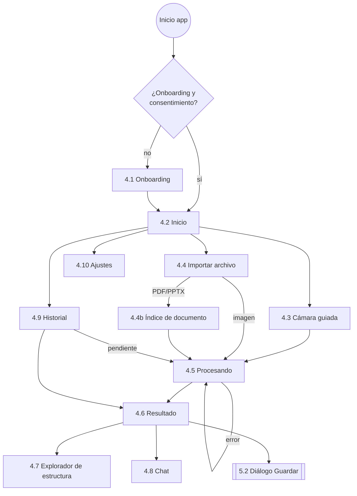

# VisionDesc UdeA — Diseño de la interfaz accesible

> **Estado:** Fase 2 (diseño, sin código) · **Versión:** 1.0 · **Fecha:** 2026-10-14
> **Complementa:** [ARQUITECTURA.md](ARQUITECTURA.md) · **Norma:** WCAG 2.2 AA (algunos criterios AAA adoptados) · **Plataforma:** solo Android
>
> **Front de demostración implementado (decisión D10):** Inicio (4.2), Capturar (4.3, sin cámara real), Importar (4.4a, sin selector real), Resultado de ejemplo (4.6), Historial con datos de ejemplo (4.9) y Ajustes (4.10: tema, nivel de detalle, velocidad y vibración, que sí se guardan). En el Resultado, la barra de lectura usa el lector de pantalla ("Leer sección") en lugar del TTS propio, que llegará después. El resto de este documento describe el diseño objetivo.

---

## Índice

0. [Convenciones de este documento](#0-convenciones-de-este-documento)
1. [Sistema de diseño accesible](#1-sistema-de-diseño-accesible)
2. [Patrones globales de interacción](#2-patrones-globales-de-interacción)
3. [Mapa de navegación](#3-mapa-de-navegación)
4. [Pantallas](#4-pantallas)
   - 4.1 [Onboarding y configuración inicial](#41-onboarding-y-configuración-inicial)
   - 4.2 [Inicio](#42-inicio)
   - 4.3 [Cámara guiada](#43-cámara-guiada)
   - 4.4 [Importar archivo e índice de documento](#44-importar-archivo-e-índice-de-documento)
   - 4.5 [Procesando](#45-procesando)
   - 4.6 [Resultado](#46-resultado)
   - 4.7 [Explorador de estructura](#47-explorador-de-estructura)
   - 4.8 [Chat de preguntas](#48-chat-de-preguntas)
   - 4.9 [Historial](#49-historial)
   - 4.10 [Ajustes](#410-ajustes)
5. [Diálogos compartidos](#5-diálogos-compartidos)
6. [Comandos de voz](#6-comandos-de-voz)
7. [Localización (ARB)](#7-localización-arb)
8. [Checklist de aceptación por pantalla](#8-checklist-de-aceptación-por-pantalla)

---

## 0. Convenciones de este documento

| Término | Significado |
|---|---|
| **Orden de foco** | Orden en el que TalkBack (deslizar a la derecha) recorre los elementos. Es también el orden de tabulación con teclado externo o Switch Access. |
| **Etiqueta** (`label`) | Lo que el lector dice como nombre del elemento. **Empieza con el texto visible** (WCAG 2.5.3). |
| **Valor** (`value`) | Estado variable que el lector lee después de la etiqueta ("1,0 por, normal"). |
| **Pista** (`hint`) | Instrucción breve. El lector la añade al final ("toca dos veces para…"); se usa poco para no alargar. |
| **Rol** | `button`, `header`, `toggled`, `selected`, `slider` (ajustable), `textField`, `image`, `liveRegion`. |
| **Anuncio** | Mensaje enviado con el `Announcer` (`SemanticsService` + texto de estado `liveRegion`). No mueve el foco. |
| **[H]** | Elemento marcado como encabezado (`Semantics(header: true)`). |
| **Háptica** | Patrón definido en ARQUITECTURA.md §3.8 (`tap`, `captura`, `estable`, `exito`, `error`, `escucha_inicio`, `escucha_fin`). |

En los wireframes, `[ Botón ]` es un control táctil, `( )`/`(•)` son opciones de radio, `[x]` es un interruptor activado y `▓▓` es contenido visual sin semántica (vista de cámara).

En las tablas de orden de foco, las etiquetas se escriben literalmente en español; los textos entre `{llaves}` son variables.

---

## 1. Sistema de diseño accesible

### 1.1 Colores y contraste (valores verificados)

Los contrastes se calcularon con la fórmula de luminancia relativa de WCAG 2.x. En la Fase 3 se protegen con un test unitario sobre `color_tokens.dart`.

| Token | Claro | Oscuro | Alto contraste |
|---|---|---|---|
| `background` | `#FFFFFF` | `#121417` | `#000000` |
| `surface` | `#F3F5F8` | `#1E2126` | `#000000` |
| `onBackground` (texto) | `#1A1C1E` → **17.1:1** | `#E3E5E8` → **14.6:1** | `#FFFFFF` → **21:1** |
| `onSurfaceVariant` (texto secundario) | `#44474E` → **8.5:1** | `#C4C7CC` → **9.5:1** | `#FFFFFF` → **21:1** |
| `primary` / `onPrimary` | `#00573A` / `#FFFFFF` → **8.7:1** | `#7FD8AA` / `#00210F` → **10.1:1** | `#FFE14D` / `#000000` → **16.1:1** |
| `error` / `onError` | `#B3261E` / `#FFFFFF` → **6.5:1** | `#FFB4AB` / `#3B0905` → **10.1:1** | `#FF9A8F` / `#000000` → **10.3:1** |
| `warningContainer` / `onWarning` | `#FFF1D6` / `#7A4B00` → **6.6:1** | `#3D2A00` / `#FFD597` → **10.0:1** | `#000000` / `#FFE14D` → **16.1:1** |
| `outline` (bordes, no textual ≥ 3:1) | `#6F7378` → **4.8:1** | `#8E9196` → **5.8:1** | `#FFFFFF` → **21:1** |
| `focus` (anillo de foco) | `#1D4ED8` → **6.7:1** | `#8AB4FF` → **8.8:1** | `#00E5FF` → **13.7:1** |

- **Todos los textos superan 4.5:1 (AA) y además 7:1 (AAA)**, excepto el error y la advertencia en el tema claro (6.5:1 y 6.6:1, AA).
- **Anillo de foco:** se dibuja **por fuera** del componente, con 2 dp de separación y 3 dp de grosor, de modo que contrasta con el **fondo** y no con el botón (sobre `primary`, el color de foco solo daría 1.2-1.3:1). Esto cumple 2.4.7 y se acerca a 2.4.13 (AAA).
- **Alto contraste:** sin sombras ni degradados, bordes blancos de 2 dp en todos los controles y en las tarjetas, y amarillo sobre negro para la acción principal (combinación preferida por muchas personas con baja visión).
- El color **nunca** es el único indicador: los estados llevan icono y texto ("Incierto", "Error", "Activado").

### 1.2 Tipografía

| Estilo | Tamaño base | Peso | Uso |
|---|---|---|---|
| `titleLarge` | 26 sp | 700 | Título de pantalla [H] |
| `titleMedium` | 22 sp | 700 | Encabezado de sección [H] |
| `bodyLarge` | **18 sp** | 400 | Texto general (más grande que el estándar de Material, 16 sp) |
| `labelLarge` | 18 sp | 600 | Texto de botones |
| `code` | 17 sp, monoespaciada | 400 | Código, con números de línea |

- Interlineado de 1.5 y espaciado entre párrafos de 1.5 × el tamaño (cumple 1.4.12 por diseño).
- Se respeta `MediaQuery.textScaler` sin límite superior. Se prueba con **2.0** y la pantalla de resultado también con **3.0**.
- No se fijan alturas a contenedores con texto; todas las pantallas desplazan su contenido (`SingleChildScrollView`/`ListView`).
- Fuente: Roboto, la del sistema Android. Se respeta el ajuste de "texto en negrita" del sistema (`MediaQuery.boldText`).

### 1.3 Dimensiones

| Constante (`dimensions.dart`) | Valor |
|---|---|
| `minTapTarget` | 48 × 48 dp (todos los controles) |
| `largeButtonHeight` | 88 dp (botones del inicio, "Tomar foto", acciones principales) |
| `captureButtonSize` | 104 dp de diámetro |
| `spacingBetweenTargets` | 12 dp como mínimo |
| `pagePadding` | 16 dp (24 dp en tabletas) |
| `cornerRadius` | 12 dp |

### 1.4 Diseño adaptable

- **Reflujo:** con `textScaler ≥ 1.5` o con un ancho menor de 360 dp, las cuadrículas de 2 columnas pasan a **1 columna** (`LayoutBuilder`).
- **Orientación:** vertical y horizontal. En horizontal, la cámara muestra los controles a la derecha y el reproductor del resultado se mantiene arriba.
- **Movimiento:** con `MediaQuery.disableAnimations`, las transiciones son instantáneas y no hay animaciones decorativas.

### 1.5 Componentes base (`core/accessibility/widgets/`)

| Componente | Garantías |
|---|---|
| `AccessibleButton` | ≥ 48 dp; etiqueta obligatoria; háptica `tap`; anillo de foco exterior; `excludeSemantics` del icono; variante `large` (88 dp). |
| `ScreenTitle` | Texto [H] y `FocusOnMount`: al entrar a la pantalla recibe el foco del lector y se anuncia (ver 2.2). |
| `SectionHeader` | [H] con `Semantics(header: true)`, más un `GlobalKey` para saltar a la sección. |
| `StatusRegion` | Texto visible con `Semantics(liveRegion: true)`; vacío si no hay estado. Lo usa el `Announcer` como respaldo en Android. |
| `Stepper±` (`AdjustableValue`) | Botones "−" y "+" visibles de 48 dp **y** un nodo semántico ajustable (`onIncrease`/`onDecrease`, `value`, `increasedValue`, `decreasedValue`). Sustituye a los `Slider` (arrastre, 2.5.7). |
| `AccessibleRadioGroup` | Cada opción con `inMutuallyExclusiveGroup`, `checked` y la etiqueta "Opción X, 2 de 4". |
| `AccessibleSwitchTile` | Etiqueta + `toggled`; toda la fila es táctil (≥ 48 dp). |
| `InfoBanner` | Tipos: información, advertencia, error y sin conexión. Icono + texto + acción opcional. **No desaparece solo.** |
| `ActionListItem` | Elemento de lista con acción principal (toque) y **acciones personalizadas** (`CustomSemanticsAction`), además de un botón "Más opciones" visible con el mismo menú. |

---

## 2. Patrones globales de interacción

### 2.1 Estructura común de una pantalla

```text
┌──────────────────────────────────────┐
│ [←Atrás]  Título de pantalla   [🎤]  │  ← AppBar: Atrás · Título [H] · Comando de voz
├──────────────────────────────────────┤
│ (StatusRegion / InfoBanner si aplica)│  ← estado: sin conexión, pendientes, errores
│                                      │
│  Contenido desplazable               │
│                                      │
└──────────────────────────────────────┘
```

- **El botón "Comando de voz" (🎤) aparece siempre en la misma posición** (esquina superior derecha), en todas las pantallas excepto en el onboarding (WCAG 3.2.3 y 3.2.6).
- Orden de foco base: **Título [H] → Atrás → Comando de voz → estado → contenido**. El título va primero porque recibe el foco al entrar; "Atrás" está al alcance enseguida.
- El botón o gesto Atrás de Android y "Atrás" en la AppBar tienen el mismo efecto.

### 2.2 Al entrar a una pantalla

1. Se pone el foco del lector en el `ScreenTitle` (`FocusOnMount`, tras el primer fotograma).
2. El lector lee el título. **No se hace un anuncio adicional** con el mismo texto (se evitan duplicados).
3. Si hay un estado importante (por ejemplo, "Sin conexión"), se anuncia **después** del título, con 500 ms de espera.

### 2.3 Mensajes de estado y confirmaciones

| Tipo | Canal |
|---|---|
| Progreso y estado | Anuncio + `StatusRegion` visible. **Sin mover el foco.** |
| Éxito ("Guardado en Bases de datos") | Anuncio + háptica `exito`. |
| Error | Anuncio + háptica `error` + `InfoBanner` de error con un botón de acción. El foco **sí** va al banner si el error bloquea la tarea (por ejemplo, un permiso denegado). |
| Acción destructiva | Diálogo de confirmación (§5.1) y luego "Deshacer" durante 10 s. |

**No se usan `SnackBar`** para información importante: desaparecen solos y el lector puede no llegar a leerlos.

### 2.4 Gestos

- Solo se usan los gestos estándar del lector: tocar dos veces para activar, deslizar para navegar y explorar al tacto.
- **No hay** deslizar para borrar, mantener pulsado como única vía, arrastres, pellizcos ni gestos personalizados.
- Las acciones secundarias de una lista están disponibles de **tres formas**: el menú de acciones del lector (`CustomSemanticsAction`: menú de acciones de TalkBack), un botón "Más opciones" visible y comandos de voz.
- Los listados largos se pueden recorrer por **encabezados** (selector de lectura "Encabezados" de TalkBack).

### 2.5 Política de voz

Resumen de ARQUITECTURA.md §3.7:
- Los estados cortos los dice **el lector de pantalla** (con la voz y la velocidad del estudiante).
- La **lectura larga** con TTS se inicia **solo a petición** del estudiante (o automáticamente, si lo activó en Ajustes).
- Al pulsar 🎤 se detiene el TTS, se espera a que el lector termine y se emite la háptica `escucha_inicio`.

---

## 3. Mapa de navegación



---

## 4. Pantallas

Cada pantalla incluye: **wireframe**, **orden de foco con etiquetas y roles**, **anuncios**, **háptica**, **gestos y comandos de voz**, y **notas**.

---

### 4.1 Onboarding y configuración inicial

Flujo de **7 pasos** con botones "Anterior" y "Siguiente". **No se pasa de paso deslizando** (el `PageView` tiene el desplazamiento desactivado), para que un deslizamiento del lector no cambie de paso por accidente.

```text
Paso 1 — Bienvenida             Paso 2 — Privacidad              Paso 3 — Voz
┌────────────────────────┐      ┌────────────────────────┐      ┌────────────────────────┐
│ Paso 1 de 7            │      │ Paso 2 de 7            │      │ Paso 3 de 7            │
│ Bienvenido a           │      │ Tu privacidad      [H] │      │ Voz de lectura     [H] │
│ VisionDesc         [H] │      │                        │      │                        │
│                        │      │ Qué se envía: solo la  │      │ Velocidad              │
│ Describe diagramas,    │      │ imagen o archivo que   │      │ [ − ]  1,0×  [ + ]     │
│ diapositivas, pizarras │      │ elijas analizar…       │      │                        │
│ y código para que      │      │                        │      │ Tono                   │
│ puedas estudiarlos     │      │ ⚠ Servicio gratuito:   │      │ [ − ]  Normal [ + ]    │
│ con tu lector de       │      │ Google puede usar el   │      │                        │
│ pantalla.              │      │ contenido para mejorar │      │ Voz                    │
│                        │      │ sus productos. No      │      │ (•) Español Colombia   │
│                        │      │ fotografíes datos      │      │ ( ) Español México     │
│                        │      │ personales.            │      │ ( ) Español España     │
│                        │      │                        │      │                        │
│                        │      │ Tu historial se guarda │      │ [  Probar voz  ]       │
│                        │      │ solo en este teléfono. │      │                        │
│                        │      │                        │      │                        │
│                        │      │ [ Leer política completa ]    │                        │
│                        │      │ [x] Acepto el envío…   │      │                        │
├────────────────────────┤      ├────────────────────────┤      ├────────────────────────┤
│        [ Siguiente ]   │      │ [Anterior] [Siguiente] │      │ [Anterior] [Siguiente] │
└────────────────────────┘      └────────────────────────┘      └────────────────────────┘

Paso 4 — Detalle               Paso 5 — Apariencia               Paso 6 — Permisos
┌────────────────────────┐      ┌────────────────────────┐      ┌────────────────────────┐
│ Paso 4 de 7            │      │ Paso 5 de 7            │      │ Paso 6 de 7            │
│ Nivel de detalle   [H] │      │ Apariencia         [H] │      │ Permisos           [H] │
│                        │      │                        │      │                        │
│ ( ) Breve              │      │ ( ) Igual que el       │      │ Cámara: para fotogra-  │
│     Resumen y lo       │      │     sistema            │      │ fiar la pizarra.       │
│     principal          │      │ ( ) Claro              │      │ [ Permitir cámara ]    │
│ (•) Estándar           │      │ ( ) Oscuro             │      │ Estado: Permitido ✓    │
│     Recomendado        │      │ (•) Alto contraste     │      │                        │
│ ( ) Exhaustivo         │      │                        │      │ Micrófono: para        │
│     Todo lo visible    │      │ Vista previa:          │      │ comandos y preguntas   │
│                        │      │ ┌────────────────────┐ │      │ por voz.               │
│                        │      │ │ Texto de ejemplo   │ │      │ [ Permitir micrófono ] │
│                        │      │ │ [Botón de ejemplo] │ │      │ Estado: Sin solicitar  │
│                        │      │ └────────────────────┘ │      │                        │
│                        │      │ El tamaño del texto se │      │ Puedes omitir este     │
│                        │      │ ajusta en tu teléfono. │      │ paso y darlos después. │
├────────────────────────┤      ├────────────────────────┤      ├────────────────────────┤
│ [Anterior] [Siguiente] │      │ [Anterior] [Siguiente] │      │ [Anterior] [Siguiente] │
└────────────────────────┘      └────────────────────────┘      └────────────────────────┘

Paso 7 — Listo
┌────────────────────────┐
│ Paso 7 de 7            │
│ Todo listo         [H] │
│                        │
│ Resumen de tu          │
│ configuración:         │
│ Voz Español Colombia,  │
│ velocidad 1,0×.        │
│ Detalle estándar.      │
│ Tema alto contraste.   │
│                        │
│ [ Ver tutorial de      │
│   comandos de voz ]    │
├────────────────────────┤
│ [Anterior] [ Empezar ] │
└────────────────────────┘
```

**Orden de foco (paso 2, el más crítico):**

| # | Elemento | Rol | Etiqueta / valor |
|---|---|---|---|
| 1 | Título | header | "Paso 2 de 7. Tu privacidad" (una sola etiqueta combinada) |
| 2 | Bloque "Qué se envía" | texto | Párrafo completo como un nodo |
| 3 | Aviso del servicio gratuito | texto | "Advertencia. Servicio gratuito: Google puede usar el contenido…" (el icono ⚠ se verbaliza como "Advertencia") |
| 4 | Bloque "Dónde se guarda" | texto | — |
| 5 | Leer política completa | button | "Leer política completa" → abre una pantalla con el texto y encabezados |
| 6 | Casilla | checkbox | "Acepto el envío de imágenes a Google para su análisis", valor "no marcada" |
| 7 | Anterior | button | "Anterior" |
| 8 | Siguiente | button | "Siguiente". **Desactivado** hasta marcar la casilla; su semántica dice "Siguiente, desactivado. Marca la casilla de aceptación para continuar." |

**Pasos 3 a 6:**
- Velocidad y tono son `AdjustableValue`. Valor: "1,0 por, normal" (0,5× a 2,0× en pasos de 0,1). Cada cambio reproduce la frase "Así sonará la lectura" con la nueva velocidad.
- "Probar voz" lee una descripción de ejemplo de 2 frases.
- Paso 5: al elegir un tema, se aplica de inmediato y se anuncia "Tema alto contraste aplicado". Si el lector de pantalla está activo, el tema por defecto es "Igual que el sistema".
- Paso 6: antes del diálogo del sistema se explica el motivo. Si se deniega, el estado cambia a "Denegado. Puedes activarlo en los ajustes del teléfono" y aparece el botón "Abrir ajustes del teléfono".

**Anuncios:**

| Momento | Anuncio |
|---|---|
| Cambio de paso | (Lo lee el título al recibir el foco.) |
| Casilla marcada | "Aceptado. Ya puedes continuar." |
| Permiso concedido | "Permiso de cámara concedido." + háptica `exito` |
| Fin | "Configuración guardada. Pantalla de inicio." |

**Notas:**
- Si el lector está activo, el tutorial (paso 7) explica cómo usar los encabezados y el botón de comando de voz.
- Todo lo configurado se puede cambiar después en Ajustes.
- Si se rechaza el consentimiento, se puede salir del onboarding con "Continuar sin analizar": la app queda limitada al historial y los ajustes.

---

### 4.2 Inicio

```text
┌──────────────────────────────────────┐
│ VisionDesc                     [🎤]  │
├──────────────────────────────────────┤
│ ┌──────────────────────────────────┐ │
│ │ ⓘ Tienes 2 materiales pendientes │ │  ← InfoBanner (solo si aplica)
│ │   [ Ver pendientes ]             │ │
│ └──────────────────────────────────┘ │
│ ┌───────────────┐ ┌───────────────┐  │
│ │      📷       │ │      📄       │  │
│ │   Capturar    │ │   Importar    │  │  ← 2×2; con texto grande pasa a 1 columna
│ │               │ │   archivo     │  │
│ └───────────────┘ └───────────────┘  │
│ ┌───────────────┐ ┌───────────────┐  │
│ │      🕘       │ │      ⚙        │  │
│ │   Historial   │ │    Ajustes    │  │
│ └───────────────┘ └───────────────┘  │
│ ┌──────────────────────────────────┐ │
│ │ 🎤  Comando de voz               │ │  ← ancho completo, 88 dp
│ └──────────────────────────────────┘ │
│                                      │
│ Último análisis:                     │
│ [ Diagrama de clases: Sistema de     │
│   pedidos. Hace 2 horas. ]           │
└──────────────────────────────────────┘
```

**Orden de foco:**

| # | Elemento | Rol | Etiqueta | Pista |
|---|---|---|---|---|
| 1 | Título | header | "VisionDesc, inicio" | — |
| 2 | Comando de voz (AppBar) | button | "Comando de voz" | "Di, por ejemplo, capturar o historial" |
| 3 | Banner de pendientes (si aplica) | texto + button | "Tienes 2 materiales pendientes por analizar" · "Ver pendientes" | — |
| 4 | Capturar | button | "Capturar" | "Fotografía la pizarra o una diapositiva" |
| 5 | Importar archivo | button | "Importar archivo" | "Imagen, PDF o PowerPoint" |
| 6 | Historial | button | "Historial" | — |
| 7 | Ajustes | button | "Ajustes" | — |
| 8 | Comando de voz (grande) | button | "Comando de voz" | — |
| 9 | Último análisis (si existe) | button | "Último análisis: {titulo}. {tiempo}" | — |

- Los iconos son decorativos (`ExcludeSemantics`); la etiqueta es solo el texto.
- En el inicio, el botón 🎤 de la AppBar se **oculta** porque está el botón grande (se evitan duplicados en el recorrido). Se mantiene la **posición visual** reservada para que la interfaz sea consistente.

**Anuncios:** sin conexión → "Sin conexión. Puedes capturar y consultar el historial; el análisis se hará cuando vuelva la conexión."

**Háptica:** `tap` en cada botón.

**Comandos de voz:** "capturar", "importar", "historial", "ajustes", "último análisis", "pendientes", "ayuda".

---

### 4.3 Cámara guiada

```text
┌──────────────────────────────────────┐
│ [←Atrás]  Capturar             [🎤]  │
├──────────────────────────────────────┤
│ ┌──────────────────────────────────┐ │
│ │ GUÍA: Acerca el teléfono.        │ │  ← StatusRegion grande (22 sp), liveRegion
│ │ Luz: buena · Nitidez: baja       │ │
│ └──────────────────────────────────┘ │
│ ▓▓▓▓▓▓▓▓▓▓▓▓▓▓▓▓▓▓▓▓▓▓▓▓▓▓▓▓▓▓▓▓▓▓▓▓ │
│ ▓▓▓▓▓▓▓▓ vista de la cámara ▓▓▓▓▓▓▓▓ │  ← ExcludeSemantics (no se anuncia)
│ ▓▓▓▓▓▓▓▓▓▓▓▓▓▓▓▓▓▓▓▓▓▓▓▓▓▓▓▓▓▓▓▓▓▓▓▓ │
│ ▓▓▓▓▓▓▓▓▓▓▓▓▓▓▓▓▓▓▓▓▓▓▓▓▓▓▓▓▓▓▓▓▓▓▓▓ │
├──────────────────────────────────────┤
│ Tipo: [ Detectar automáticamente ▾ ] │
│ [ Guía por voz: Sí ] [ Linterna: No ]│
│ [ Captura automática: No ]           │
│              ┌──────┐                │
│              │  ◯   │  Tomar foto    │  ← 104 dp, centrado abajo
│              └──────┘                │
└──────────────────────────────────────┘
```

**Orden de foco:**

| # | Elemento | Rol | Etiqueta / valor |
|---|---|---|---|
| 1 | Título | header | "Capturar" |
| 2 | Atrás | button | "Atrás" |
| 3 | Comando de voz | button | "Comando de voz" |
| 4 | Guía | liveRegion | "Guía: Acerca el teléfono. Luz buena. Nitidez baja." |
| 5 | Tipo de material | button (abre lista) | "Tipo de material", valor "Detectar automáticamente" |
| 6 | Guía por voz | toggle | "Guía por voz", activado |
| 7 | Linterna | toggle | "Linterna", desactivado |
| 8 | Captura automática | toggle | "Captura automática", desactivado |
| 9 | Tomar foto | button | "Tomar foto" · pista: "También puedes decir: capturar" |

La vista de la cámara se excluye de la semántica: no aporta información al lector y obligaría a recorrer un elemento vacío.

**Guía por voz y vibración** (ARQUITECTURA.md §3.5):

| Condición detectada | Mensaje de voz (antirrebote de 3 s) | Háptica |
|---|---|---|
| Moviéndose | — (solo vibración) | Pulso corto cada 400 ms |
| Estable | "Imagen estable" | `estable` (2 cortos) |
| Poca luz | "Hay poca luz. Activa la linterna o acércate a una ventana." | — |
| Reflejo | "Hay un reflejo fuerte. Inclina un poco el teléfono." | — |
| Borrosa | "La imagen está borrosa. Mantén el teléfono quieto." | — |
| Contenido cortado | "Hay contenido cortado a la {izquierda/derecha/arriba/abajo}. Mueve el teléfono hacia ese lado." | — |
| Muy lejos / muy cerca | "Acerca el teléfono" / "Aleja el teléfono" | — |
| Todo correcto | "Lista para capturar" | `estable` |

- La guía **no habla mientras el estudiante navega** con el lector (se detecta el cambio de foco semántico) para no pisar la lectura de los controles. El texto de la guía sigue visible y se actualiza.
- El mensaje de guía es el **mismo texto** en la `StatusRegion` y en la voz, para que las personas con baja visión también lo lean.

**Tras pulsar "Tomar foto":**

1. Háptica `captura` y anuncio "Foto tomada. Revisando la calidad."
2. Si la calidad es buena → pasa directo a **Procesando** (4.5).
3. Si la calidad es dudosa → un diálogo (§5.3) con el foco en el título:

```text
┌──────────────────────────────────┐
│ La foto parece borrosa      [H]  │
│ Puede que la descripción sea     │
│ incompleta.                      │
│ [ Repetir foto ]  (foco inicial) │
│ [ Analizar de todas formas ]     │
└──────────────────────────────────┘
```

**Permiso denegado:** la vista se sustituye por un `InfoBanner` de error con el foco: "La app necesita permiso de cámara para capturar. [Abrir ajustes del teléfono] [Importar una imagen en su lugar]".

**Comandos de voz:** "capturar" / "tomar foto", "linterna", "silenciar guía", "tipo diagrama de clases" (o cualquier tipo), "atrás".

---

### 4.4 Importar archivo e índice de documento

**4.4a Importar:** al pulsar "Importar archivo" se muestra una hoja con tres opciones (no se abre directamente el selector del sistema, para que el estudiante sepa qué va a pasar):

```text
┌──────────────────────────────────────┐
│ [←Atrás]  Importar archivo     [🎤]  │
├──────────────────────────────────────┤
│ [ 🖼  Imagen de la galería        ]  │
│ [ 📄  PDF                         ]  │
│ [ 📊  Presentación PowerPoint     ]  │
│                                      │
│ Tamaño máximo: 20 MB.                │
└──────────────────────────────────────┘
```

| # | Elemento | Rol | Etiqueta |
|---|---|---|---|
| 1 | Título | header | "Importar archivo" |
| 2-3 | Atrás, Comando de voz | button | — |
| 4 | Imagen | button | "Imagen de la galería" |
| 5 | PDF | button | "PDF" |
| 6 | Presentación | button | "Presentación PowerPoint" |
| 7 | Nota | texto | "Tamaño máximo: 20 megabytes." |

Al volver del selector del sistema se anuncia: "Archivo seleccionado: {nombre}, {n} páginas". Una **imagen** va directamente a Procesando; un **PDF o PPTX** va al índice.

**4.4b Índice de documento:**

```text
┌──────────────────────────────────────┐
│ [←Atrás]  Clase5_Redes.pdf     [🎤]  │
├──────────────────────────────────────┤
│ 24 páginas. Elige una para analizar. │
│ ⚠ Presentación: la disposición       │  ← solo PPTX
│   visual puede no ser exacta.        │
│                                      │
│ [ Página 1 de 24: Modelo OSI.        │
│   Diapositiva de título. ]           │
│ [ Página 2 de 24: Capas del modelo.  │
│   Diagrama de capas. ]               │
│ [ Página 3 de 24: … ]                │
│ …                                    │
│ [ Ir a la página… ]                  │
└──────────────────────────────────────┘
```

- **PDF:** el índice lo genera Gemini (ARQUITECTURA.md §2.5). Mientras llega, la pantalla muestra el estado de Procesando con el texto "Generando el índice del documento".
- **PPTX:** el índice es local e instantáneo, con el título y el número de imágenes de cada diapositiva.
- Cada elemento es un `ActionListItem`: "Página 2 de 24: Capas del modelo. Diagrama de capas." Al tocar dos veces → Procesando de esa página.
- **"Ir a la página…"** abre un diálogo con un campo numérico (teclado numérico) para no tener que recorrer 24 elementos.
- Los análisis de páginas ya hechos llevan el sufijo ", ya analizada", que abre directamente el resultado.

---

### 4.5 Procesando

Esta pantalla **no depende de ningún spinner**: el progreso es texto, voz y vibración.

```text
┌──────────────────────────────────────┐
│ Analizando                     [🎤]  │
├──────────────────────────────────────┤
│ ┌──────────────────────────────────┐ │
│ │ Esperando la respuesta…          │ │  ← StatusRegion grande, liveRegion
│ └──────────────────────────────────┘ │
│                                      │
│ Pasos                           [H]  │
│ ✓ Imagen preparada                   │
│ ✓ Enviada al servicio                │
│ … Esperando respuesta                │
│ ○ Organizando la descripción         │
│                                      │
│ ════════════════════                 │  ← barra visual indeterminada (ExcludeSemantics)
│                                      │
│ [ Cancelar ]                         │
└──────────────────────────────────────┘
```

**Orden de foco:**

| # | Elemento | Rol | Etiqueta |
|---|---|---|---|
| 1 | Título | header | "Analizando" |
| 2 | Comando de voz | button | — |
| 3 | Estado | liveRegion | "Esperando la respuesta…" |
| 4 | Encabezado "Pasos" | header | "Pasos" |
| 5-8 | Pasos | texto | "Imagen preparada, completado" / "Esperando respuesta, en curso" / "Organizando la descripción, pendiente" |
| 9 | Cancelar | button | "Cancelar análisis" |

En esta pantalla **no hay botón "Atrás"**: "Cancelar" lo sustituye, y el botón Atrás del sistema muestra el diálogo "¿Cancelar el análisis?".

**Anuncios (con `SemanticsService` y la `StatusRegion` de respaldo):**

| Momento | Anuncio | Háptica |
|---|---|---|
| Entrada | "Analizando imagen. Esto suele tardar unos segundos." | `tap` |
| Envío completado | (sin anuncio, para no saturar; el paso se marca en la lista) | — |
| Cada 8 s esperando (configurable, 0 = desactivado) | "Sigo analizando." | Pulso suave |
| Reintento | "El servicio está ocupado. Reintento {n} de 3." | — |
| Éxito | "Análisis listo: {tipo}. {titulo}." → navega a Resultado | `exito` |
| Error | Mensaje del error (ARQUITECTURA.md §6.1) | `error` |
| Cancelado | "Análisis cancelado." → vuelve a la pantalla anterior | — |

**Estado de error** (en la misma pantalla, el foco va al banner):

```text
│ ┌──────────────────────────────────┐ │
│ │ ✕ El servicio de análisis no     │ │
│ │   responde.                      │ │
│ │ [ Reintentar ] [ Guardar en      │ │
│ │                  pendientes ]    │ │
│ └──────────────────────────────────┘ │
```

**Comandos de voz:** "cancelar", "estado" (repite el estado actual).

---

### 4.6 Resultado

Pantalla central de la app. Las secciones se navegan por **encabezados**, y el reproductor de lectura está **arriba**, para que el estudiante llegue a él sin recorrer todo el contenido. Su posición visual y su orden de foco coinciden (WCAG 1.3.2).

```text
┌──────────────────────────────────────┐
│ [←Atrás] Diagrama de clases:   [🎤][⋮]│  ← título = {titulo}; ⋮ = Más opciones
│          Sistema de pedidos          │
├──────────────────────────────────────┤
│ Lectura                         [H]  │
│ [⏮ Anterior] [▶ Reproducir] [Sig. ⏭] │
│ [↻ Repetir sección]                  │
│ Velocidad [ − ] 1,0× [ + ]           │
│ Leyendo: Resumen                     │  ← liveRegion (solo cambios de sección)
├──────────────────────────────────────┤
│ ⚠ Confianza media. La parte inferior │  ← InfoBanner (si hay advertencias)
│   derecha está borrosa.              │
│                                      │
│ [ Secciones ▾ ]                      │  ← índice para saltar
│                                      │
│ Resumen                         [H]  │
│ Diagrama de clases UML con 8 clases  │
│ que modela un sistema de pedidos…    │
│                                      │
│ Descripción detallada           [H]  │
│ Parte superior izquierda: la clase   │
│ Usuario tiene tres atributos…        │
│ Parte superior derecha: …            │
│                                      │
│ Estructura                      [H]  │
│ 8 nodos y 9 relaciones.              │
│ [ Explorar estructura ]              │
│                                      │
│ Texto detectado                 [H]  │
│ …                                    │
│                                      │
│ Código (Java)                   [H]  │
│ [ Copiar código ] [ Leer código ]    │
│  1  public class Usuario {           │
│  2      private String nombre;       │
│                                      │
│ Conceptos clave                 [H]  │
│ Herencia, multiplicidad, …           │
│                                      │
│ Aviso                                │
│ Descripción generada por IA; puede   │
│ contener errores.                    │
├──────────────────────────────────────┤
│ [ Hacer una pregunta ] [ Guardar ]   │
└──────────────────────────────────────┘
```

**Orden de foco:**

| # | Elemento | Rol | Etiqueta / valor |
|---|---|---|---|
| 1 | Título | header | "Diagrama de clases: Sistema de pedidos" |
| 2 | Atrás | button | "Atrás" |
| 3 | Comando de voz | button | "Comando de voz" |
| 4 | Más opciones | button | "Más opciones" → menú: Copiar todo, Exportar a texto, Compartir, Analizar de nuevo como…, Borrar |
| 5 | "Lectura" | header | "Lectura" |
| 6 | Sección anterior | button | "Sección anterior" |
| 7 | Reproducir / Pausar | button | "Reproducir" ↔ "Pausar" (la etiqueta cambia; sin `toggled`, para que el lector diga la acción) |
| 8 | Sección siguiente | button | "Sección siguiente" |
| 9 | Repetir sección | button | "Repetir sección" |
| 10 | Velocidad | adjustable | "Velocidad", valor "1,0 por" |
| 11 | Estado de lectura | liveRegion | "Leyendo: Resumen" |
| 12 | Advertencias (si hay) | texto | "Advertencia. Confianza media. La parte inferior derecha está borrosa." |
| 13 | Secciones | button | "Ir a sección" → lista de secciones; al elegir una, el foco va a su encabezado |
| 14 | "Resumen" | header | "Resumen" |
| 15 | Texto del resumen | texto | (un nodo) |
| 16 | "Descripción detallada" | header | — |
| 17…n | Párrafo por región | texto | "Parte superior izquierda: la clase Usuario…" (un nodo por región) |
| … | "Estructura" | header | — |
| … | Conteo | texto | "8 nodos y 9 relaciones" |
| … | Explorar estructura | button | "Explorar estructura" |
| … | "Texto detectado" | header | — |
| … | Bloques de texto | texto | Un nodo por bloque |
| … | "Código (Java)" | header | "Código, lenguaje Java" |
| … | Copiar código / Leer código | button | "Copiar código" / "Leer código en voz alta" |
| … | Líneas de código | texto | "Línea 1: public class Usuario abre llave" (con el lector se verbalizan los símbolos con `CodeVerbalizer`; el texto visible es literal) |
| … | "Conceptos clave" | header | — |
| … | Aviso de IA | texto | "Descripción generada por inteligencia artificial; puede contener errores." |
| último-1 | Hacer una pregunta | button | "Hacer una pregunta sobre este material" |
| último | Guardar | button | "Guardar en historial" ↔ "Guardado en {materia}" (cuando ya está guardado, abre el diálogo para moverlo) |

**Detalles de accesibilidad:**
- **Secciones vacías:** no se muestran (por ejemplo, si no hay código, no aparece el encabezado "Código").
- **Código en inglés:** las líneas de código usan `attributedLabel` con `LocaleStringAttribute(en-US)` para que el lector las pronuncie en inglés, y los comentarios en español con su configuración regional.
- **Tablas:** en esta pantalla solo se muestra un resumen ("Tabla de 4 filas y 3 columnas: Producto, Cantidad, Precio") y el botón "Explorar tabla" lleva al explorador en modo tabla. No se muestran tablas visuales grandes, porque `Table` de Flutter tiene una semántica pobre.
- **Elementos inciertos:** los nodos con `incierto: true` se marcan con el texto ", incierto" (no solo con estilo visual).
- **Barra de lectura con TTS:** al reproducir, se resalta visualmente la sección leída (borde con `focus`) y se actualiza "Leyendo: …". **El foco del lector no se mueve** con el TTS.

**Anuncios:**

| Acción | Anuncio | Háptica |
|---|---|---|
| Entrada (desde Procesando) | (El título recibe el foco.) Después: "{n} advertencias" si las hay. | — |
| Reproducir | "Leyendo {sección}" | `tap` |
| Pausar | "Pausado" | `tap` |
| Cambio de velocidad | "Velocidad {v} por" | `tap` |
| Copiar | "Copiado al portapapeles" | `exito` |
| Exportar | (se abre el diálogo de compartir del sistema con el `.txt`) | — |
| Guardar | "Guardado en {materia}, clase del {fecha}" | `exito` |

**Comandos de voz:** "reproducir", "pausa", "siguiente", "anterior", "repetir", "más rápido", "más lento", "ir a código", "ir a estructura", "explorar", "preguntar {pregunta}", "guardar", "copiar", "exportar".

**Lectura automática:** si está activada en Ajustes y el lector **no** está activo, el TTS lee el resumen al entrar. Con el lector activo, no se lee automáticamente (ARQUITECTURA.md §3.7).

---

### 4.7 Explorador de estructura

Permite recorrer el diagrama **nodo por nodo**, la jerarquía de un mapa mental o una **tabla celda por celda**, sin depender de la posición visual.

#### Modo nodos (diagramas)

```text
┌──────────────────────────────────────┐
│ [←Atrás]  Estructura           [🎤]  │
├──────────────────────────────────────┤
│ Modo: (•) Nodos ( ) Jerarquía        │
│       ( ) Tabla                      │  ← solo los modos aplicables
├──────────────────────────────────────┤
│ ┌──────────────────────────────────┐ │
│ │ Nodo 3 de 8                      │ │  ← tarjeta del nodo actual
│ │ Clase Usuario                    │ │
│ │ Atributos: nombre, correo, id    │ │
│ │ Métodos: registrar(), login()    │ │
│ └──────────────────────────────────┘ │
│ [ ◀ Nodo anterior ] [ Nodo sig. ▶ ]  │
│ [ Ir a nodo… ]  [ Volver al nodo     │
│                   anterior visitado ]│
│                                      │
│ Conexiones (2)                  [H]  │
│ [ → Pedido: asociación. Un Usuario   │
│     tiene muchos Pedidos (uno a      │
│     muchos). ]                       │
│ [ ← Persona: herencia. Usuario       │
│     hereda de Persona. ]             │
│                                      │
│ [ 🔊 Leer nodo ]                     │
└──────────────────────────────────────┘
```

**Orden de foco:**

| # | Elemento | Rol | Etiqueta |
|---|---|---|---|
| 1 | Título | header | "Estructura: {titulo}" |
| 2-3 | Atrás, Comando de voz | button | — |
| 4 | Modo | radio group | "Modo de exploración: Nodos, seleccionado, 1 de 3" |
| 5 | Tarjeta del nodo | texto | "Nodo 3 de 8: Clase Usuario. Atributos: nombre, correo, id. Métodos: registrar, login. 2 conexiones." |
| 6 | Nodo anterior | button | "Nodo anterior" |
| 7 | Nodo siguiente | button | "Nodo siguiente" |
| 8 | Ir a nodo… | button | "Ir a nodo" → lista de todos los nodos ("Nodo 1 de 8: Clase Persona") |
| 9 | Volver | button | "Volver al nodo anterior visitado" (desactivado si no hay historial) |
| 10 | "Conexiones (2)" | header | "Conexiones, 2" |
| 11…n | Cada conexión | button | "Ir a Pedido. Asociación: un Usuario tiene muchos Pedidos, uno a muchos." |
| último | Leer nodo | button | "Leer nodo en voz alta" |

**Comportamiento clave:**
- Al pulsar "Nodo siguiente", **el foco se queda en el botón** (para poder pulsarlo varias veces seguidas) y se **anuncia** la descripción completa del nuevo nodo. La tarjeta se actualiza visualmente.
- Al pulsar una **conexión**, se navega a ese nodo: se anuncia "Pedido, nodo 5 de 8…" y el foco va a la tarjeta (es un salto, no un recorrido).
- El orden de los nodos es el **orden de lectura espacial** que asigna el modelo (n1, n2…). La lista "Ir a nodo" permite ordenar alfabéticamente.
- **Direccionalidad:** las conexiones salientes se verbalizan como "hacia" y las entrantes como "desde": "Desde Persona: herencia. Usuario hereda de Persona".
- **Diagramas de secuencia y de flujo:** se añade el botón "Seguir el flujo" (siguiente mensaje o paso según `orden`): "Paso 4 de 12: Usuario envía 'login' a Servidor".

#### Modo jerarquía (mapas mentales)

```text
│ ┌──────────────────────────────────┐ │
│ │ Nivel 2 · Rama 1 de 4            │ │
│ │ Protocolos de transporte         │ │
│ │ Padre: Redes de computadores     │ │
│ │ Hijos: 2 (TCP, UDP)              │ │
│ └──────────────────────────────────┘ │
│ [ ↑ Subir al padre ]                 │
│ [ ↓ Entrar al primer hijo ]          │
│ [ ◀ Hermano anterior ] [ Hermano ▶ ] │
```

Etiqueta de la tarjeta: "Protocolos de transporte. Nivel 2, rama 1 de 4. Padre: Redes de computadores. 2 hijos: TCP, UDP." Cada botón se desactiva (con su motivo en la semántica: "Subir al padre, desactivado, estás en la idea central") cuando no aplica.

#### Modo tabla

```text
│ ┌──────────────────────────────────┐ │
│ │ Fila 2 de 4 · Columna 3 de 3     │ │
│ │ Precio: 25.000                   │ │
│ └──────────────────────────────────┘ │
│         [ ↑ Fila anterior ]          │
│ [ ← Columna ant. ] [ Columna sig. → ]│
│         [ ↓ Fila siguiente ]         │
│ [ Leer fila completa ] [ Leer columna]│
```

- Anuncio al moverse: "{encabezado de columna}: {valor}. Fila {r}, columna {c}". Ejemplo: "Precio: 25.000. Fila 2, columna 3".
- **"Leer fila completa":** "Fila 2: Producto, Teclado. Cantidad, 3. Precio, 25.000".
- Al llegar al borde: "Última columna" + háptica `error` suave.

**Comandos de voz (todos los modos):** "siguiente", "anterior", "ir a {nombre}", "conexiones", "padre", "hijo", "arriba", "abajo", "izquierda", "derecha", "leer fila", "seguir flujo", "leer".

---

### 4.8 Chat de preguntas

**Decisión de diseño:** el área para preguntar está **arriba** y los mensajes se ordenan **del más reciente al más antiguo**. Con lector de pantalla, la convención visual de los chats (campo abajo, mensajes nuevos abajo) obliga a recorrer toda la conversación para llegar al campo o a la última respuesta. Aquí todo queda a pocos deslizamientos.

```text
┌──────────────────────────────────────┐
│ [←Atrás]  Preguntas            [🎤]  │
│           Diagrama de clases…        │
├──────────────────────────────────────┤
│ ┌──────────────────────────────────┐ │
│ │ Escribe tu pregunta              │ │  ← TextField con etiqueta visible
│ └──────────────────────────────────┘ │
│ [ 🎤 Preguntar por voz ] [ Enviar ]  │
│                                      │
│ Sugerencias                     [H]  │
│ [ Explícame el diagrama paso a paso ]│
│ [ ¿Qué relación hay entre…? ]        │
│ [ Resume en una frase ]              │
│                                      │
│ Esperando respuesta…                 │  ← liveRegion
│                                      │
│ Conversación                    [H]  │
│ ┌──────────────────────────────────┐ │
│ │ Respuesta · 10:42                │ │
│ │ Dos clases heredan de Persona:   │ │
│ │ Estudiante y Profesor.           │ │
│ │ [ 🔊 Leer ] [ Copiar ]           │ │
│ └──────────────────────────────────┘ │
│ ┌──────────────────────────────────┐ │
│ │ Tu pregunta · 10:42              │ │
│ │ ¿Cuántas clases heredan de       │ │
│ │ Persona?                         │ │
│ └──────────────────────────────────┘ │
└──────────────────────────────────────┘
```

**Orden de foco:**

| # | Elemento | Rol | Etiqueta |
|---|---|---|---|
| 1 | Título | header | "Preguntas sobre: {titulo}" |
| 2-3 | Atrás, Comando de voz | button | — |
| 4 | Campo de texto | textField | "Escribe tu pregunta" (etiqueta visible persistente, no solo un *placeholder*) |
| 5 | Preguntar por voz | button | "Preguntar por voz" |
| 6 | Enviar | button | "Enviar pregunta" (desactivado si el campo está vacío, con el motivo en la semántica) |
| 7 | "Sugerencias" | header | — |
| 8-10 | Sugerencias | button | El texto de la sugerencia; al tocar se envía directamente |
| 11 | Estado | liveRegion | "Esperando respuesta…" / vacío |
| 12 | "Conversación" | header | "Conversación, {n} mensajes" |
| 13…n | Mensajes | grupo | "Respuesta, 10:42: Dos clases heredan…" seguido de los botones "Leer respuesta" y "Copiar respuesta" |

**Flujo y anuncios:**

| Momento | Anuncio | Háptica | Foco |
|---|---|---|---|
| Pulsar "Preguntar por voz" | (se espera al lector) "Escuchando" | `escucha_inicio` | Se queda en el botón |
| Fin de la escucha | "Entendí: {pregunta}. Enviando." | `escucha_fin` | — |
| Error de reconocimiento | "No te entendí. Toca dos veces para intentarlo de nuevo." | `error` | — |
| Respuesta recibida | **La respuesta completa se anuncia** ("Respuesta: …"). Si supera 400 caracteres, se anuncian las 2 primeras frases y "Respuesta larga; está en la conversación". | `exito` | **No se mueve.** El estudiante puede ir a la conversación (2 deslizamientos) |
| Sin conexión | `InfoBanner` "Para hacer preguntas necesitas conexión a Internet". El campo y los botones quedan desactivados con ese motivo; la conversación sigue disponible. | — | — |

- Tras enviar por texto, el campo se vacía y **el foco vuelve al campo**, listo para otra pregunta.
- Preguntas por voz: antes de enviarlas se muestran en el campo durante 1,5 s, con la opción "Cancelar envío" (configurable), para corregir errores de reconocimiento.

**Comandos de voz** (dentro del chat, todo lo que no es un comando se trata como pregunta): "repetir respuesta", "leer conversación", "borrar conversación", "atrás".

---

### 4.9 Historial

```text
┌──────────────────────────────────────┐
│ [←Atrás]  Historial            [🎤]  │
├──────────────────────────────────────┤
│ ┌──────────────────────────────────┐ │
│ │ Buscar en el historial           │ │
│ └──────────────────────────────────┘ │
│ [ Materia: Todas ▾ ] [ Fecha: Cual- │
│   quiera ▾ ] [ Tipo: Todos ▾ ]       │
│ [ Limpiar filtros ]                  │
│ 12 resultados                        │  ← liveRegion
│                                      │
│ Pendientes por analizar (2)     [H]  │  ← solo si hay
│ [ Foto del 14 oct, 10:05  ] [⋮]      │
│                                      │
│ Bases de datos                  [H]  │  ← agrupado por materia
│  Clase del 13 oct: Normalización     │  ← subgrupo (texto, no header)
│  [ Diagrama entidad-relación:        │
│    Biblioteca. Ayer. ]          [⋮]  │
│  [ Tabla: Formas normales. Ayer ][⋮] │
│                                      │
│ Ingeniería de software          [H]  │
│  …                                   │
│                                      │
│ [ Gestionar materias ]               │
└──────────────────────────────────────┘
```

**Orden de foco:**

| # | Elemento | Rol | Etiqueta / valor |
|---|---|---|---|
| 1 | Título | header | "Historial" |
| 2-3 | Atrás, Comando de voz | button | — |
| 4 | Buscar | textField (search) | "Buscar en el historial" |
| 5 | Filtro de materia | button | "Filtro de materia", valor "Todas" → diálogo con radio (§5.4) |
| 6 | Filtro de fecha | button | "Filtro de fecha", valor "Cualquiera" → Hoy / Última semana / Último mes / Elegir rango (con selector de fecha accesible del sistema) |
| 7 | Filtro de tipo | button | "Filtro de tipo", valor "Todos" → Diagramas, Mapas mentales, Diapositivas, Pizarra, Código, Tablas |
| 8 | Limpiar filtros | button | Visible solo si hay filtros activos |
| 9 | Conteo | liveRegion | "12 resultados" |
| 10 | "Pendientes (2)" | header | "Pendientes por analizar, 2" |
| 11… | Pendiente | ActionListItem | "Foto del 14 de octubre, 10:05, pendiente". Acciones: Analizar ahora, Asignar materia, Borrar |
| … | Encabezado de materia | header | "Bases de datos, 5 elementos" |
| … | Elemento | ActionListItem | "Diagrama entidad-relación: Biblioteca. Clase del 13 de octubre, Normalización. Ayer." Acción principal: abrir resultado. Acciones personalizadas: **Preguntar**, **Exportar**, **Mover a otra materia**, **Renombrar**, **Borrar** |
| … | Más opciones de cada elemento | button | "Más opciones de {titulo}" (mismo menú que las acciones personalizadas, para quien no usa el lector) |
| último | Gestionar materias | button | → lista de materias con Renombrar / Borrar (con borrado en cascada y confirmación §5.1) |

**Comportamiento:**
- La búsqueda filtra mientras se escribe (con 400 ms de espera). Se **anuncia el conteo** al terminar ("3 resultados"), pero no con cada letra.
- El orden es de lo más reciente a lo más antiguo, agrupado por materia (alfabético). Hay una opción "Agrupar por fecha" en el menú.
- **Historial vacío:** "Aún no tienes análisis guardados." + botón "Capturar ahora".
- **Borrar:** confirmación (§5.1) → "Borrado. Deshacer" (banner de 10 s con el botón "Deshacer" accesible; el foco no se mueve).
- **Funciona sin conexión.** "Analizar ahora" en un pendiente sin conexión se desactiva con el motivo.

**Comandos de voz:** "buscar {texto}", "filtrar por {materia}", "mostrar pendientes", "limpiar filtros", "abrir el último".

---

### 4.10 Ajustes

```text
┌──────────────────────────────────────┐
│ [←Atrás]  Ajustes              [🎤]  │
├──────────────────────────────────────┤
│ Voz                             [H]  │
│ Velocidad   [ − ] 1,0× [ + ]         │
│ Tono        [ − ] Normal [ + ]       │
│ Voz: Español Colombia ▸              │
│ [x] Leer el resultado automáticamente│
│ [ Probar voz ]                       │
│                                      │
│ Descripción                     [H]  │
│ Nivel de detalle: Estándar ▸         │
│ Anuncio de progreso: cada 8 s ▸      │
│                                      │
│ Apariencia                      [H]  │
│ Tema: Alto contraste ▸               │
│                                      │
│ Cámara                          [H]  │
│ [x] Guía por voz                     │
│ [x] Vibración al encuadrar           │
│ [ ] Captura automática               │
│                                      │
│ Retroalimentación               [H]  │
│ [x] Vibración                        │
│                                      │
│ Privacidad y datos              [H]  │
│ [ Qué información se envía ]         │
│ [ Revocar consentimiento ]           │
│ [ Borrar todos mis datos ]           │  ← estilo de error
│                                      │
│ Ayuda                           [H]  │
│ [ Lista de comandos de voz ]         │
│ [ Cómo usar la app con TalkBack ]    │
│ [ Repetir configuración inicial ]    │
│                                      │
│ Acerca de                       [H]  │
│ Versión 1.0.0 · Modelo:              │
│ gemini-3.8-flash                     │
└──────────────────────────────────────┘
```

**Orden de foco:** el visual, de arriba abajo. Cada grupo empieza con su encabezado [H], de modo que el estudiante puede saltar entre grupos.

| Control | Rol | Etiqueta / valor |
|---|---|---|
| Velocidad, Tono | adjustable + botones ± | "Velocidad", "1,0 por". Al cambiar, se reproduce una muestra |
| Voz | button | "Voz", valor "Español Colombia" → lista de voces **instaladas** en español. Si no hay ninguna: "No hay voces en español instaladas" + "Abrir ajustes de voz del teléfono" |
| Interruptores | toggle | "Leer el resultado automáticamente", activado. Pista (si el lector está activo): "Con el lector de pantalla activo se recomienda desactivarlo" |
| Nivel de detalle | button → diálogo con radio | "Nivel de detalle", valor "Estándar" |
| Anuncio de progreso | button → radio | "Anuncio de progreso", valor "Cada 8 segundos" (opciones: 5 s, 8 s, 15 s, desactivado) |
| Tema | button → radio | "Tema", valor "Alto contraste" (Sistema / Claro / Oscuro / Alto contraste). Se aplica y se anuncia al instante |
| Borrar todos mis datos | button | "Borrar todos mis datos". Confirmación reforzada (§5.1, escribir o decir "borrar") |
| Acerca de | texto | "Versión 1.0.0. Modelo de análisis: gemini-3.8-flash" |

- Los cambios se guardan **al instante** (no hay botón "Guardar") y se anuncian: "Nivel de detalle: Exhaustivo".
- El tamaño del texto **no** se ajusta aquí: se respeta el del sistema. Hay una nota con el botón "Abrir ajustes de accesibilidad del teléfono".

---

## 5. Diálogos compartidos

Todos los diálogos: el foco va al **título** [H] al abrirse y vuelve al elemento que los abrió al cerrarse. Se cierran con Atrás o con el gesto de escape. Los botones miden ≥ 48 dp y se apilan verticalmente cuando el texto es grande.

### 5.1 Confirmación destructiva

```text
┌──────────────────────────────────┐
│ ¿Borrar este análisis?      [H]  │
│ Se borrarán la imagen, la        │
│ descripción y la conversación.   │
│ [ Cancelar ]      ← foco inicial │
│ [ Borrar ]        ← color error  │
└──────────────────────────────────┘
```

- El foco inicial va al título y la **primera acción en el orden es "Cancelar"** (opción segura).
- Para **"Borrar todos mis datos"** se añade un campo: "Escribe BORRAR para confirmar". También se puede decir "borrar" con el micrófono del diálogo.

### 5.2 Guardar en historial

```text
┌──────────────────────────────────┐
│ Guardar en historial        [H]  │
│ Materia                          │
│ [ Bases de datos ▾ ]             │  ← recuerda la última usada (3.3.7)
│ [ + Nueva materia ]              │
│ Clase                            │
│ Fecha: [ Hoy, 14 oct ▾ ]         │
│ Tema (opcional)                  │
│ [ Normalización              ]   │
│ [ Cancelar ]  [ Guardar ]        │
└──────────────────────────────────┘
```

- Etiquetas: "Materia, Bases de datos", "Nueva materia", "Fecha de la clase, hoy, 14 de octubre", "Tema de la clase, opcional".
- Si se guarda sin materia → queda en "Sin clasificar".
- Al guardar: anuncio "Guardado en Bases de datos, clase del 14 de octubre" + háptica `exito`.

### 5.3 Calidad de foto dudosa

Descrito en 4.3. El foco inicial va a "Repetir foto".

### 5.4 Selector de opciones (radio)

Lista de `AccessibleRadioGroup`. Al seleccionar se aplica y se cierra. Etiqueta de cada opción: "{opción}, {i} de {n}", con el estado seleccionado.

### 5.5 Analizar de nuevo como…

Lista de tipos de material (el mismo selector que en la cámara). Al elegir uno → Procesando con la plantilla del tipo (ARQUITECTURA.md §4.4). El análisis anterior se conserva hasta que llega el nuevo.

---

## 6. Comandos de voz

El reconocimiento es **local** (`VoiceCommandParser`) y no distingue tildes ni mayúsculas.

| Ámbito | Comando (y sinónimos) | Acción |
|---|---|---|
| **Global** | "inicio" | Ir al inicio |
| | "capturar" / "tomar foto" / "cámara" | Ir a la cámara (si ya está en ella, captura) |
| | "importar" / "abrir archivo" | Importar |
| | "historial" / "mis análisis" | Historial |
| | "ajustes" / "configuración" | Ajustes |
| | "atrás" / "volver" | Atrás |
| | "ayuda" / "qué puedo decir" | Lee los comandos disponibles **en la pantalla actual** |
| | "cancelar" | Cancela la acción en curso |
| | "repetir" | Repite el último anuncio o lectura |
| **Cámara** | "linterna", "silenciar guía", "tipo {tipo}" | — |
| **Resultado** | "reproducir", "pausa", "siguiente", "anterior", "más rápido", "más lento", "ir a {sección}", "explorar", "guardar", "copiar", "exportar", "preguntar {texto}" | — |
| **Explorador** | "siguiente", "anterior", "ir a {nodo}", "padre", "hijo", "arriba", "abajo", "izquierda", "derecha", "leer fila", "seguir flujo" | — |
| **Chat** | Cualquier frase que no sea un comando → pregunta | — |
| **Historial** | "buscar {texto}", "filtrar por {materia}", "pendientes", "abrir el último" | — |

- **Comando no reconocido** (fuera del chat): "No reconocí el comando '{texto}'. Di 'ayuda' para escuchar las opciones."
- **Comando que no aplica en la pantalla:** "El comando 'explorar' está disponible en la pantalla de resultado."
- **Sin reconocimiento de voz disponible:** "El reconocimiento de voz no está disponible en este teléfono. Usa los botones." El botón 🎤 queda desactivado con ese motivo.

---

## 7. Localización (ARB)

- Archivo: `lib/l10n/app_es.arb` (plantilla). `l10n.yaml` con `synthetic-package: false` y salida en `lib/l10n/generated/`.
- **Ningún texto visible ni semántico se escribe directamente en el código**: etiquetas, pistas, anuncios y mensajes de error salen del ARB.
- **Convención de claves:** `{pantalla}{Elemento}{Propiedad}` en camelCase. Por ejemplo, `homeCaptureButtonLabel`, `homeCaptureButtonHint`, `processingRetryAnnouncement`.
- Plurales y variables con **ICU**. Las fechas se formatean con `intl` y la configuración regional `es_CO`.

```json
{
  "@@locale": "es",

  "homeCaptureButtonLabel": "Capturar",
  "homeCaptureButtonHint": "Fotografía la pizarra o una diapositiva",

  "processingRetryAnnouncement": "El servicio está ocupado. Reintento {attempt} de {max}.",
  "@processingRetryAnnouncement": {
    "placeholders": { "attempt": { "type": "int" }, "max": { "type": "int" } }
  },

  "explorerNodePosition": "Nodo {current} de {total}: {label}.",
  "@explorerNodePosition": {
    "placeholders": {
      "current": { "type": "int" }, "total": { "type": "int" }, "label": { "type": "String" }
    }
  },

  "historyResultsCount": "{count, plural, =0{Sin resultados} =1{1 resultado} other{{count} resultados}}",
  "@historyResultsCount": { "placeholders": { "count": { "type": "int" } } },

  "resultConnectionsHeader": "{count, plural, =0{Sin conexiones} =1{1 conexión} other{{count} conexiones}}",
  "@resultConnectionsHeader": { "placeholders": { "count": { "type": "int" } } },

  "relationOneToMany": "uno a muchos",
  "relationManyToMany": "muchos a muchos",
  "relationInheritance": "{child} hereda de {parent}",
  "@relationInheritance": {
    "placeholders": { "child": { "type": "String" }, "parent": { "type": "String" } }
  }
}
```

Las verbalizaciones del dominio (cardinalidades, tipos de relación y símbolos de código) también viven en el ARB. El dominio devuelve **claves y datos** y la capa de presentación construye la frase, de modo que el dominio no depende del idioma.

---

## 8. Checklist de aceptación por pantalla

Cada pantalla debe cumplir lo siguiente antes de darse por terminada (Fase 3). Los puntos con ✱ se automatizan con tests de widgets.

- [ ] ✱ `meetsGuideline(androidTapTargetGuideline)`
- [ ] ✱ `meetsGuideline(labeledTapTargetGuideline)`
- [ ] ✱ `meetsGuideline(textContrastGuideline)` en los temas **claro, oscuro y alto contraste**
- [ ] ✱ Sin desbordamientos con `textScaler` 2.0 (y 3.0 en Resultado), en vertical y en horizontal
- [ ] ✱ El título tiene `header: true` y recibe el foco al entrar
- [ ] ✱ Orden de foco igual al de la tabla de este documento (prueba con `tester.getSemantics` y recorrido)
- [ ] ✱ Los anuncios esperados se emiten (`FakeAnnouncer`) y los hápticos (`FakeHapticService`)
- [ ] ✱ Ningún texto escrito directamente en el código (lint/regla de revisión + búsqueda en CI)
- [ ] Recorrido manual completo con **TalkBack** en un emulador de Android Studio y en un teléfono real
- [ ] Recorrido con **teclado externo** y **Switch Access**
- [ ] Prueba con **Seleccionar para pronunciar** y con la **lupa** del sistema
- [ ] Revisión por al menos un estudiante usuario de lector de pantalla (recomendado)
